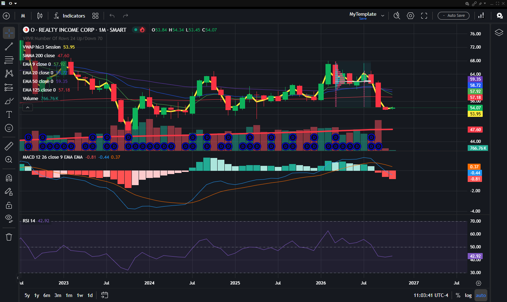
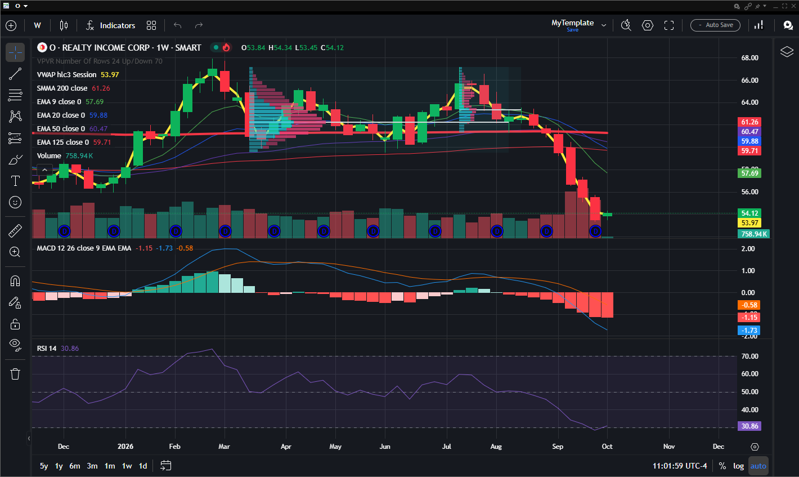
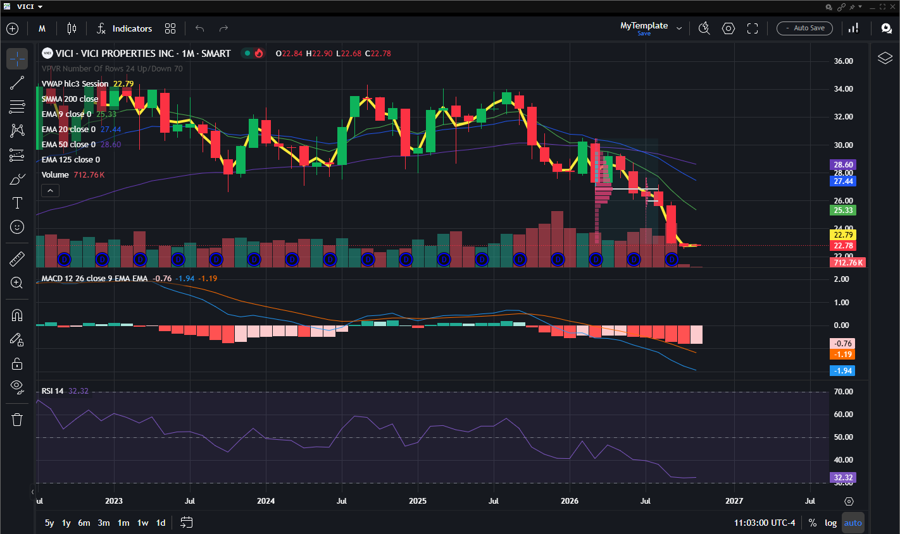
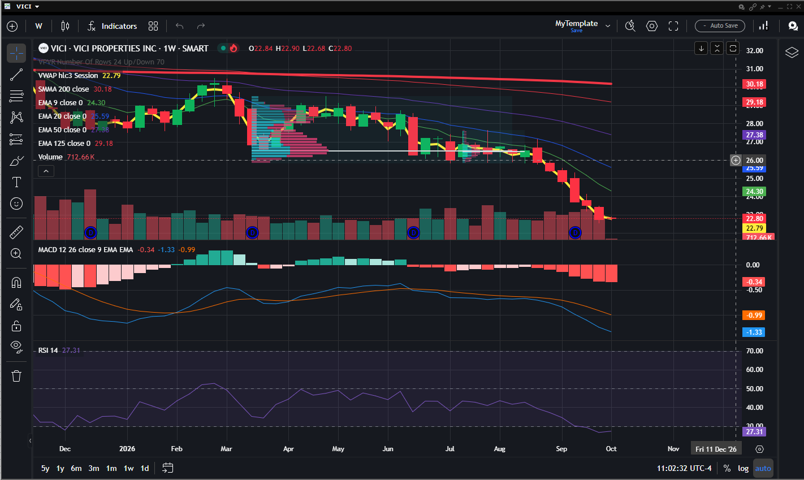

# Class 10 - Live Practice & Review

## Goal

Apply everything learned in a guided paper-trading session and review the full course.

## Topics

- Walkthrough of a live (paper trading) session
- Applying chart reading, indicators, and risk management together
- Analyzing broad market risk using major index ETFs
- Reviewing common beginner mistakes
- Q&A and next steps for continued learning

## Key Takeaways

- Consistency in applying the plan matters more than any single trade outcome.
- Paper trading is a safe way to build confidence before risking real capital.
- Continued learning and journaling are what separate long-term traders from short-term gamblers.

## Analyzing the Market Risk

Before trading an individual stock, check the broader market's risk and trend - most stocks are correlated with the overall market, so a weak or volatile market raises the risk of any single trade regardless of how good the setup looks. A quick "top-down" market risk check includes:

- Is the major index above or below its key moving averages (e.g., 50-day, 200-day)?
- Is the index making higher highs/higher lows (uptrend), or lower highs/lower lows (downtrend)?
- Is volatility elevated (wide daily ranges, large gaps) or calm?
- Are different market segments (large-cap, tech, small-cap) agreeing or diverging in direction?

### Major Indexes Monthly Analysis

Track these four major index ETFs once a month to gauge overall market risk before taking new trades:

| Ticker | Index Tracked | Segment | What to Check Monthly |
|--------|---------------|---------|------------------------|
| DIA    | Dow Jones Industrial Average | Large-cap, blue-chip | Trend direction, position vs. 50/200-day moving averages |
| VOO    | S&P 500 | Large-cap, broad market | Overall market trend, nearest support/resistance |
| QQQ    | Nasdaq-100 | Large-cap tech/growth | Momentum vs. VOO (tech leading or lagging the market) |
| IWM    | Russell 2000 | Small-cap | Risk appetite (small-caps often lead/lag in risk-on/risk-off moves) |

**Practice**: At the start of each month, pull up a chart for DIA, VOO, QQQ, and IWM. For each, note the current trend (up/down/sideways), whether price is above or below its 50-day and 200-day moving averages, and whether the four indexes agree or disagree on direction. Use this as your market risk check before sizing any new positions that month.

## Sector ETF Monthly and Weekly

After checking the broad market indexes, narrow in on a sector to see whether it is leading or lagging the overall market. Below are monthly and weekly chart examples for the Real Estate (REIT) sector, using two well-known holdings as a proxy for the sector:

### Realty Income Corp (O)

Monthly:

Weekly:

### VICI Properties Inc (VICI)

Monthly:

Weekly:

**Why look at both timeframes?**

- The monthly chart shows the big-picture, multi-year trend and keeps you from overreacting to short-term noise.
- The weekly chart shows the trend that is actually playing out right now, which is closer to your trade timing.
- If the monthly and weekly trends agree, conviction is higher; if they disagree, treat the setup as higher risk.

**Practice**: Pick a sector you are interested in (e.g., Real Estate, Technology, Energy, Financials). Find two representative stocks or ETFs in that sector, pull up their monthly and weekly charts, and note whether the two timeframes agree on trend direction.

## Final Assessment

Place three simulated trades using the full process: chart analysis, indicator confirmation, position sizing, and stop-loss placement. Review the outcomes together.
