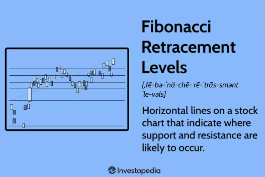
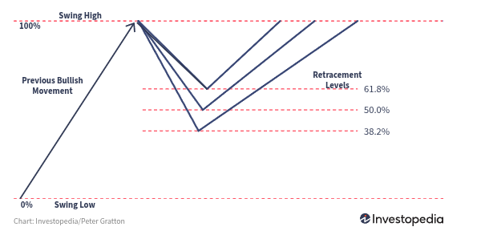
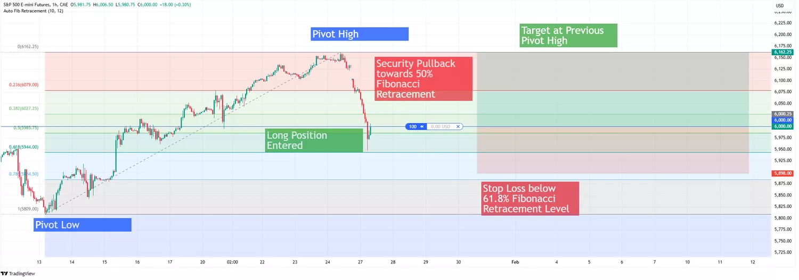
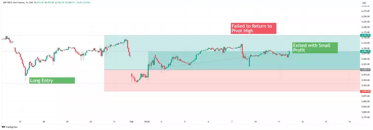

# Fibonacci Retracement Levels

### Definition

Fibonacci retracement levels are used by traders to help them find key price levels and zones where a security might stall, reverse, or continue moving within a trend. They are based on the Fibonacci sequence.

Fibonacci retracement levels are among the go-to tools for traders looking to identify potential support and resistance zones during pullbacks. 
The technical indicator is often found on leading online brokerage and trading platforms and is rooted in the Fibonacci sequence. These levels help traders spot key price areas where securities might pause, reverse, or continue trending. We take you through what you need to know below.

*Key Takeaways*

* Fibonacci retracement levels, derived from the Fibonacci sequence, are used to identify potential support and resistance levels.
* Key percentages include 23.6%, 38.2%, 50%, 61.8%, and 78.6%.
* Traders use these levels to place entry orders, set stop-loss levels, and determine price targets. The popular technical indicator can be found on popular online brokerage platforms.
* Fibonacci retracement levels are often used with other technical analysis tools to improve trading strategies.
* Risks include the potential for false signals and the need for additional confirmation.

### Understanding Fibonacci Retracement Levels

Fibonacci retracement levels are used to find potential support and resistance areas by measuring how much a security's price pulls back before continuing in its trend. 
Key levels like 38.2%, 50%, and 61.8% are widely used because they align with market psychology, support and resistance zones, and technical indicators like moving averages.

**Common Reversal Levels With Fibonacci Retracement**

Next,

**Retracement levels are calculated as follows:**

Retracement Level - Pivot High - (Retracement Percentage × Price Range)
with

`Price Range = Pivot High - Pivot Low`

For example, the 61.8% retracement level in this case would be as follows:

`Price Range = 6,162.25 - 5,809 = 353.25`

`61.8% retracement level = 6,162.25 - (0.618 × 353.25) = 6,162.25 - 218.30 = 5,944.00`

In this situation, a trader bullish on S&P 500 e-mini futures is looking for an appropriate entry price. The trader sets the pivot high and pivot low as described above on the charting platform and awaits some retracement on the security.

The security does pull back, retracing to a point between the 50% and 61.8% levels. The trader then enters a long position, with a stop-loss order a little below the 61.8% retracement level and a target of the previous pivot high.

### Ref

<https://www.investopedia.com/terms/f/fibonacciretracement.asp>

### See Also

* [Stop Order Strategies](stop_order_strategies.html)
* [Day Trading Rules & Discipline](day_trading_rules.html)
* [Risk Management Deep Dive Hub](index.html)
