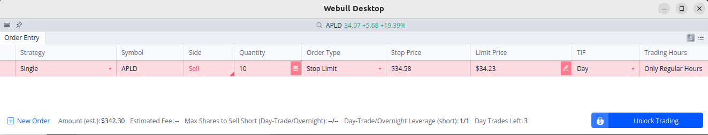
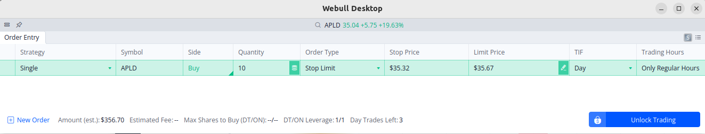

# Stop Order Strategies

## Order types

*Market order:* An order to buy or sell immediately at the best available market price. 
*Limit order:* An order to buy at a specific price or lower, or to sell at a specific price or higher. This protects you from volatility but means your order may not execute if the price isn't met. 
*Stop order (Stop-Loss):* An order to buy or sell once a "stop price" is reached. It can be used to limit losses or lock in profits. 
*Stop-limit order:* A combination order that first triggers at a stop price, and then becomes a limit order to be executed at a specific price or better.
*Trailing stop order:* A stop order with a stop parameter that adjusts as the market moves in a favorable direction, allowing profits to run while still protecting against sharp pullbacks. 

## Stop Limit order 

A **stop-limit order** is a type of advanced order used in trading to control when and at what price a trade is executed. It combines the features of a **stop order** and a **limit order**.

Here’s how it works:

---

### 🧩 **Two Key Prices**

1. **Stop price (trigger):**
   The price that activates the limit order.
   Once the market reaches or passes this price, your limit order is placed.

2. **Limit price (execution):**
   The minimum (for sell orders) or maximum (for buy orders) price at which you’re willing to trade.

---

### 💡 **Example (Sell Stop-Limit Order)**

Let’s say you own **AAPL** currently trading at **$200**, and you want to protect your profits if it starts to fall.

* **Stop price:** $195
* **Limit price:** $194



**What happens:**

* If AAPL drops to **$195**, your sell order is triggered.
* Your limit order to sell at **$194 or better** (i.e., $194–$200) is placed.
* If the stock quickly falls below **$194**, your order may **not execute**, since limit orders only fill at or above the limit price.

---

### 📈 **Example (Buy Stop-Limit Order)**

Suppose you want to buy **TSLA**, now at **$180**, only if it breaks above resistance.

* **Stop price:** $185
* **Limit price:** $186



If TSLA rises to **$185**, a **buy limit order** at **$186** or lower is placed — meaning you’ll only buy if it’s **$186 or cheaper**.

---

### ⚠️ **Pros and Cons**

| ✅ Advantages                                                   | ⚠️ Disadvantages                                        |
| -------------------------------------------------------------- | ------------------------------------------------------- |
| Prevents trades from executing at bad prices during volatility | No guarantee of execution if price skips past the limit |
| Useful for precise entry/exit strategies                       | Can miss trades in fast markets                         |
| Good for managing risk                                         | Requires careful choice of stop and limit levels        |

---

## Stop (Market) Order/Stop-Loss Order

### **Stop-Limit vs Stop-Loss (Stop-Market)**

| Feature                  | **Stop-Loss (Stop-Market)**                                                    | **Stop-Limit**                                                                  |
| ------------------------ | ------------------------------------------------------------------------------ | ------------------------------------------------------------------------------- |
| **Trigger (Stop Price)** | When the stop price is reached, a *market order* is placed.                    | When the stop price is reached, a *limit order* is placed.                      |
| **Execution Price**      | Guaranteed to execute, but **price may slip** (execute worse than stop price). | Executes only at the **limit price or better**, but **not guaranteed** to fill. |
| **Goal**                 | Ensure exit no matter what (protect capital).                                  | Control the minimum price you’ll accept (avoid bad fills).                      |
| **Best For**             | Quick exit, strong risk control.                                               | Precise trade execution, avoiding slippage.                                     |
| **Risk**                 | May sell (or buy) at a much worse price during fast drops or spikes.           | May not execute at all if price gaps beyond your limit.                         |

---

### **Example Scenario (Sell Order)**

You own a stock currently trading at **$100**, and you want to protect against a drop.

| Order Type                  | Stop Price | Limit Price | Result                                                                                                                         |
| --------------------------- | ---------- | ----------- | ------------------------------------------------------------------------------------------------------------------------------ |
| **Stop-Loss (Stop-Market)** | $95        | —           | When price hits $95, system sends a market sell order. You might get filled at $94.80, $94, or even lower if market gaps down. |
| **Stop-Limit**              | $95        | $94.50      | When price hits $95, a limit order to sell at $94.50 (or higher) is sent. If price skips below $94.50, you **won’t sell**.     |

---

### **Visual Example**

```
Price
│
│        ● $100  ← Current price
│
│        |
│        |     STOP = $95
│        |_____|_________________ ← Trigger level
│              \
│               \___ LIMIT = $94.50
│
└────────────────────────────── Time →
```

**If price dips gradually:**

* At $95 → trigger activates
* Limit sell order at $94.50 fills normally

**If price gaps sharply below $94.50 (e.g. to $93):**

* Stop-limit order **won’t execute** (no buyers at $94.50+)
* Stop-market order **will execute**, but possibly at $93

---

### **Quick Summary**

| You want to...                           | Use...                      |
| ---------------------------------------- | --------------------------- |
| Guarantee an exit no matter what         | **Stop-Loss (Stop-Market)** |
| Avoid selling too low in a volatile move | **Stop-Limit**              |

## Trailing Stops Order

Flying a plane is easy. Landing it is the challenge. Similarly, profitable trading is all about the exit. It can be hard to watch a market reverse course and wipe out all—or even a significant chunk—of the profits from a formerly winning trade. But in a trending market, how do you know when to exit?
That's when you need a trailing stop. The trick is finding a technique that strikes the right balance between letting a profitable position run and protecting profits from a reversal without getting stopped out by the market's normal ebb and flow. This is especially important in trend-following strategies, when the idea is to follow the market as long as it's trending.

### Key Takeaways

* Trailing stops are meant to protect profits in a winning trade by tracking the market, preventing big gains from turning into small ones and small gains from turning into losses.
* Finding the right balance is crucial. A stop that's too tight may result in a trader getting stopped out by the regular ups and downs of the market, while one that's too loose could mean giving back most of a big win.
* Trailing stops are best suited for trending markets, when the idea is to stick with the trade as long as it's moving in your favor.

### Ref

<https://www.investopedia.com/terms/t/trailingstop.asp>

### See Also

* [Fibonacci Retracement Levels](fibonacci_retracement_levels.html)
* [Day Trading Rules & Discipline](day_trading_rules.html)
* [Risk Management Deep Dive Hub](index.html)
