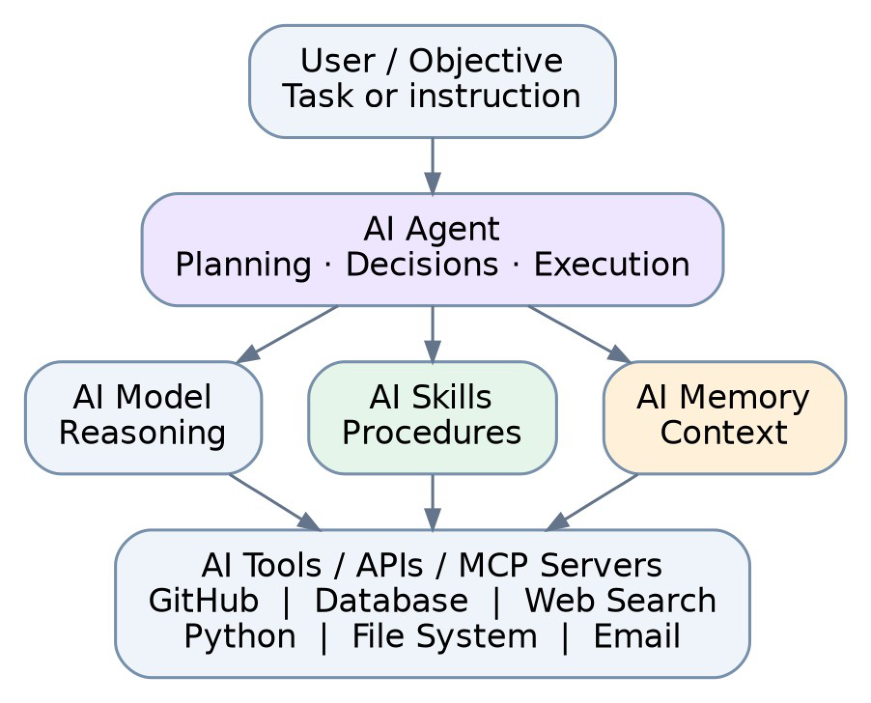
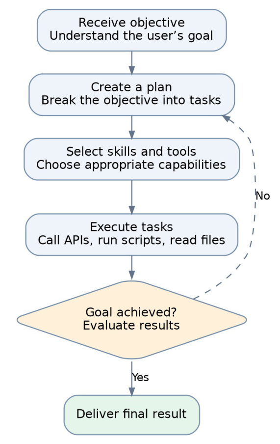
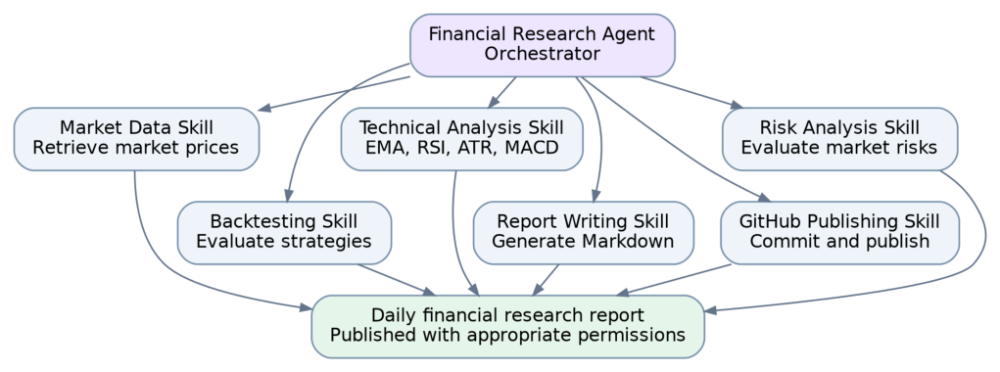
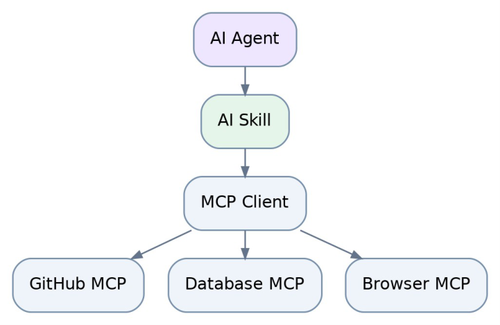
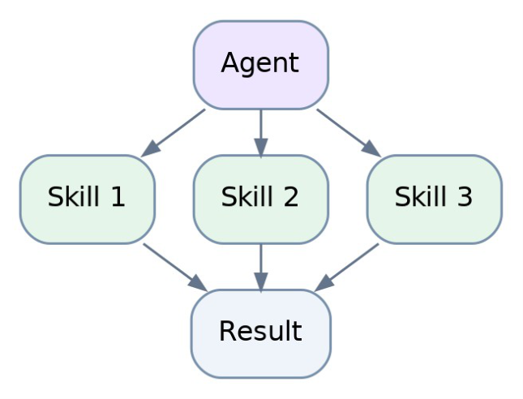
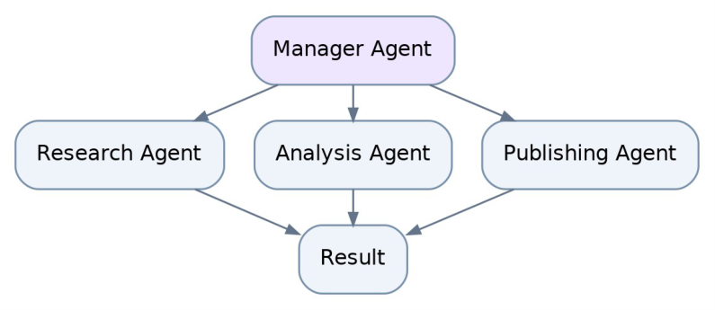

# AI Skills vs. AI Agents

AI Skills and AI Agents work together to enable AI systems to perform specialized tasks and automate complex workflows.

AI Model: the brain. AI Skill: specialized knowledge and ability. AI Tool: the instrument used to perform an operation. AI Agent: the worker who makes decisions and executes tasks. AI Workflow: the process that coordinates the work.

## **1. AI architecture**





**Figure 1. Conceptual architecture; implementations vary by platform.**

## **2. What is an AI Skill (人工智能技能)?**

An AI Skill is a reusable package of specialized instructions, domain knowledge, procedures, scripts and resources that teaches an AI system how to perform a particular task. Define instructions once and reuse them.

### **Examples of AI Skills**

|**Skill**|**Responsibility**|
|---|---|
|**Stock Analysis**|Analyze fundamentals and technical indicators|
|**ETF Research**|Compare performance, expenses and dividends|
|**GitHub Publishing**|Create documents, update menus and commit<br>changes|
|**Kubernetes**|Generate deployment YAML and troubleshoot<br>clusters|
|**PDF Generation**|Generate professionally formatted PDFs|
|**Video Generation**|Generate scripts, subtitles and narration|
|**Tax Analysis**|Perform tax calculations and comparisons|


### **AI Skill directory structure**

```
etf-research-skill/
├── SKILL.md
├── scripts/
│   ├── analyze_etf.py
│   └── backtest.py
├── references/
│   └── methodology.md
└── assets/
    └── report_template.md
```

SKILL.md is the primary instruction file in this convention.

```markdown
---
name: etf-research
description: Analyze and compare US-listed ETFs.
---
# ETF Research Skill
## Instructions
1. Retrieve historical ETF prices.
2. Calculate annualized returns.
3. Calculate maximum drawdown.
4. Compare expense ratios.
5. Analyze dividend distributions.
6. Generate comparison charts.
7. Produce a Markdown research report.
## Requirements
- Use reliable financial data.
- Include data source references.
- Distinguish price and total returns.
```

A compatible AI system can load these instructions when needed. A skill does not necessarily run independently; it is typically invoked by a model, agent or application.

## **3. What is an AI Agent (人工智能智能体)?**

An AI Agent is a software system that uses an AI model to pursue an objective, make decisions, select tools, execute tasks and evaluate results with some degree of autonomy. An agent can use multiple skills to accomplish a larger objective.

### **AI Agent execution lifecycle**





**Figure 2. Agent execution and evaluation loop.**

### **Example: Financial Research Agent**

Objective: Every morning, analyze VOO, QQQ, SPMO and SCHD, identify market risks, generate a research report and publish it to GitHub.





**Figure 3. Financial research agent coordinating six skills.**

For the localhost GitHub repository, this architecture could automate research, technical documentation and publishing while retaining approval requirements for repository changes.

## **4. AI Skill vs. AI Agent comparison**

|**Feature**|**AI Skill**|**AI Agent**|
|---|---|---|
|**Chinese name**|人工智能技能|人工智能智能体|
|**Primary purpose**|Specialized capability|Achieve an objective|
|**Decision-making**|Task procedures|Dynamic decisions|
|**Autonomy**|Generally low|Configurable|
|**Planning**|Predefined instructions|Dynamic planning|
|**Execution**|Invoked when needed|Coordinates execution|
|**Memory**|Reference resources|State and memory|
|**Tool usage**|Guides tool usage|Selects and invokes tools|
|**Scheduling**|Not inherent|Can integrate schedulers|
|**Reusability**|High|High|
|**Implementation**|Markdown, scripts, resources|Code, models, tools, skills, state|


## **5. AI Skill vs. Tool vs. MCP**

|**Component**|**Purpose**|**Example**|
|---|---|---|
|**AI Skill**|Defines how to perform a task|ETF research instructions|
|**AI Tool**|Performs an operation|Execute Python script|
|**API**|Programmatic interface|GitHub REST API|
|**MCP**|Standardizes access to tools and|GitHub MCP server|
||context||
|**AI Agent**|Coordinates components|Financial Research Agent|


MCP (Model Context Protocol) is a standardized protocol that allows AI applications to access external tools, resources and prompts.





**Figure 4. Example of skill-guided access through MCP. MCP is optional; direct APIs are also possible.**

## **6. Popular AI Agent development frameworks**

|**Framework / product**|**Developer**|**Primary purpose**|
|---|---|---|
|**OpenAI Agents SDK**|OpenAI|Agent development and<br>orchestration|
|**LangGraph**|LangChain|Stateful agent workflows|
|**CrewAI**|CrewAI|Multi-agent collaboration|
|**AutoGen**|Microsoft|Multi-agent applications|
|**Semantic Kernel**|Microsoft|Enterprise AI integration|
|**Google Agent Development Kit**|Google|Agent development|
|**Claude Code**|Anthropic|Agentic software development|
|**OpenAI Codex**|OpenAI|Agentic software engineering|


## **7. Single-agent vs. multi-agent architecture**





**Figure 5. One agent manages multiple skills. Simpler and easier to maintain.**





**Figure 6. Multiple specialized agents collaborate under an orchestrator.**

## **8. Recommended architecture for your GitHub projects**

For financial research, day trading hub, technical documentation and book publishing projects, initially use a single-agent, multi-skill architecture rather than a complicated multi-agent system.

```
ai-platform/
├── agents/
│   ├── financial_research_agent.py
│   ├── technical_documentation_agent.py
│   └── book_publishing_agent.py
├── skills/
│   ├── etf_research/SKILL.md
│   ├── technical_analysis/SKILL.md
│   ├── backtesting/SKILL.md
│   ├── markdown_generation/SKILL.md
│   └── github_publishing/SKILL.md
├── tools/
│   ├── market_data.py
│   ├── github_client.py
│   └── database.py
├── workflows/
│   ├── daily_market_review.yaml
│   └── weekly_research.yaml
├── memory/
│   └── agent_state.db
├── config/
├── logs/
└── README.md
```

Each agent could operate independently while sharing reusable skills and tools. Python could provide the execution layer, SQLite could maintain persistent state, and GitHub could provide version control. This is a proposed architecture, not an inspection or modification of the existing repository.

## **9. Summary**

|**Concept**|**Human analogy**|
|---|---|
|**LLM**|Brain|
|**AI Skill**|Professional training|
|**AI Tool**|Working instrument|
|**MCP**|Standard communication interface|
|**AI Memory**|Notebook|
|**AI Agent**|Employee|
|**Multi-agent system**|Team of employees|
|**AI Workflow**|Standard operating procedure|
|**AI Orchestrator**|Manager|


The most important distinction is that a skill defines how to perform a task, whereas an agent decides what tasks to perform, when to perform them, and which skills and tools to use to accomplish an objective.
