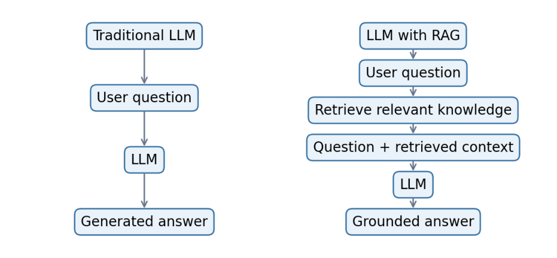
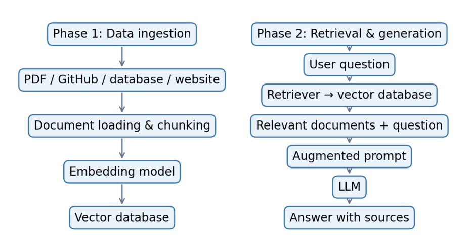
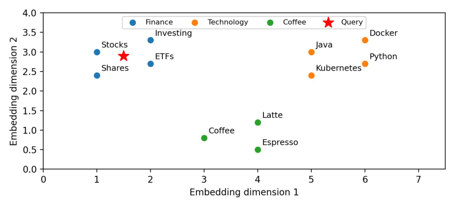
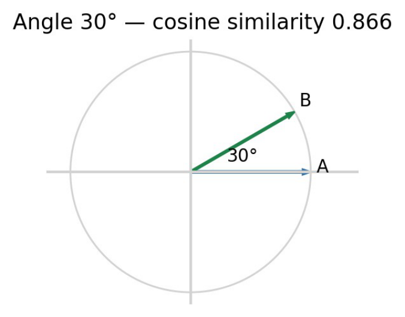
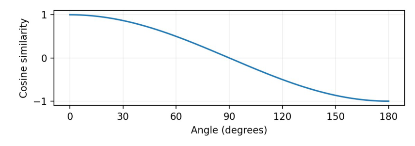
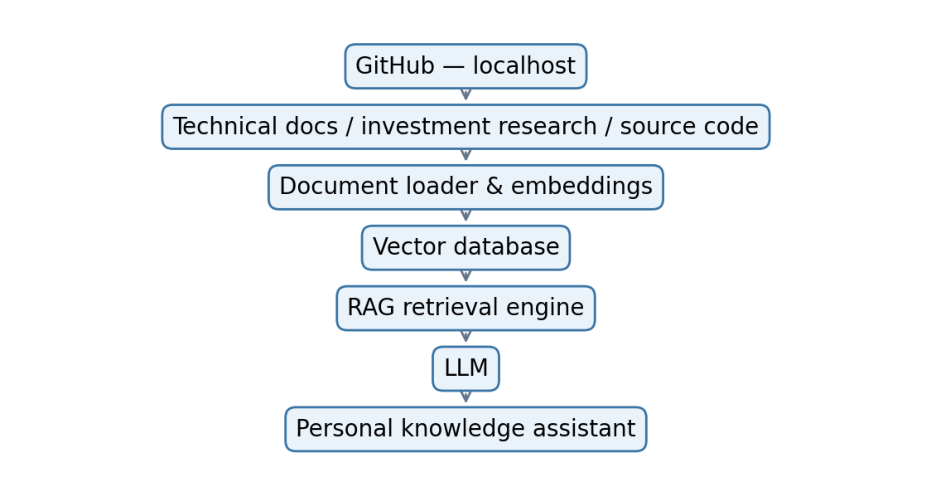
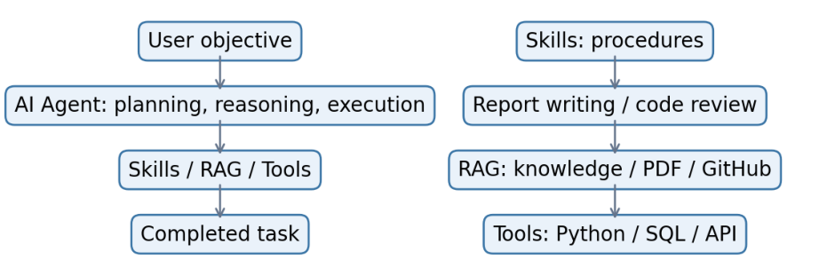
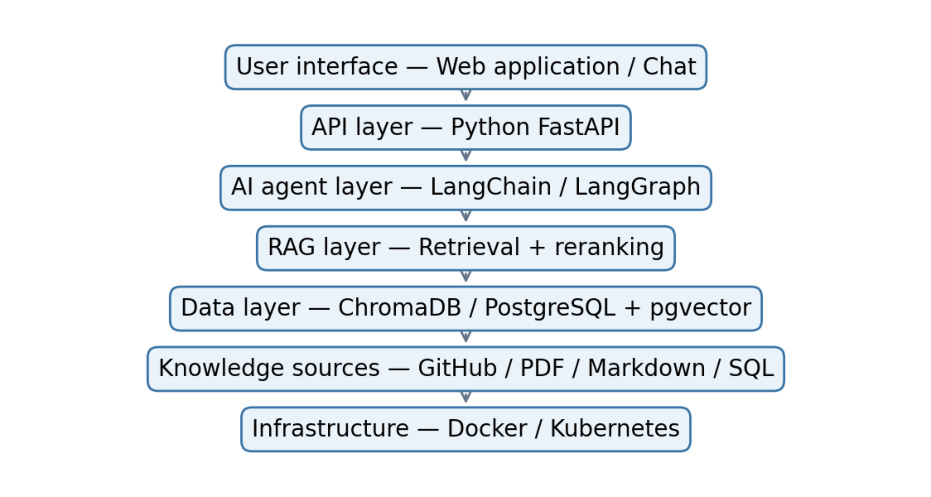

# Retrieval-Augmented Generation (RAG)

RAG is an AI architecture that enhances a Large Language Model (LLM) by retrieving relevant information from external knowledge sources before generating a response. Instead of relying entirely on training knowledge, RAG can access private documents, databases, websites, source code and updated information.

## **1. Traditional LLM vs. RAG**





|**Feature**|**Traditional LLM**|**RAG**|
|---|---|---|
|**Knowledge source**|Training data|Training + external sources|
|**Updated information**|Limited|Can retrieve current data|
|**Private documents**|Not inherently accessible|Supported through retrieval|
|**Hallucination risk**|Higher without grounding|Potentially reduced|
|**Retraining**|Sometimes|Not needed for knowledge<br>updates|
|**Source citations**|Limited|Can provide citations|
|**Enterprise knowledge**|Limited by itself|Well suited|


## **2. RAG system architecture**





Phase 1: Load PDF, Word, Markdown, HTML, source code or database records. Divide large documents into smaller chunks. Convert chunks into numerical vectors representing semantic meaning. Index vectors and associated text in a searchable database.

Phase 2: Embed the question, search the vector database, retrieve and optionally rerank relevant segments, combine them with the question, send the augmented prompt to the LLM, and generate an answer based on the retrieved context.

## **3. The three components of RAG**

|**Component**|**Purpose**|
|---|---|
|**Retrieval**|Search external knowledge sources for relevant<br>information.|
|**Augmentation**|Combine retrieved information with the original<br>prompt.|
|**Generation**|Generate a natural-language response using the<br>augmented prompt.|


## **4. What is a vector database?**

A vector database stores numerical representations of data called embeddings and supports similarity searches. “How do I purchase stocks?”, “How can I buy shares?” and “How do I invest in the stock market?” may have nearby embeddings despite different wording.





Illustrative two-dimensional projection; actual embeddings often contain hundreds or thousands of dimensions.

|**Technology**|**Description**|
|---|---|
|**ChromaDB**|Open-source, local development|
|**FAISS**|Vector similarity search library|
|**Pinecone**|Managed cloud vector database|
|**Milvus**|Scalable open-source vector database|
|**Qdrant**|Vector database with filtering|
|**Weaviate**|Hybrid search|
|**PostgreSQL + pgvector**|Vector search in relational database|
|**Elasticsearch**|Keyword, vector and hybrid search|


## **5. Cosine similarity**

Cosine similarity = (A · B) / (||A|| ||B||). The closer the value is to 1, the more closely aligned the vectors are.








Static replacement for the interactive slider: 0° = 1; 30° = 0.866; 90° = 0; 180° = −1.

## **6. Practical example: GitHub knowledge assistant**

For the localhost repository, a RAG assistant could retrieve technical documentation, investment research, trading strategies and source code before answering questions.





Example questions: What Kubernetes deployment examples have I documented? What is my ATR-based swing trading strategy? Compare the ETF investment strategies in my book. Find my previous Python backtesting implementation. Summarize my AI and machine learning documentation.

## **7. Python implementation example**

|**Component**|**Technology**|
|---|---|
|**Language**|Python|
|**LLM**|OpenAI or Ollama|
|**Framework**|LangChain|
|**Embeddings**|Hugging Face Sentence Transformers|
|**Vector database**|ChromaDB|
|**Knowledge source**|Local Markdown files|
|**API / deployment**|FastAPI / Docker or Kubernetes (optional)|


## **7. Python implementation — complete code**

Install dependencies:

```sh
pip install langchain \
    langchain-community \
    langchain-text-splitters \
    langchain-chroma \
    langchain-huggingface \
    langchain-ollama \
    sentence-transformers
ollama pull llama3.2
```

Install and start Ollama before running the application.

```python
from langchain_community.document_loaders import DirectoryLoader, TextLoader
from langchain_text_splitters import RecursiveCharacterTextSplitter
from langchain_huggingface import HuggingFaceEmbeddings
from langchain_chroma import Chroma
from langchain_ollama import ChatOllama

# 1. Load documents
loader = DirectoryLoader(
    "./documents",
    glob="**/*.md",
    loader_cls=TextLoader,
    loader_kwargs={"encoding": "utf-8"}
)
documents = loader.load()

# 2. Split documents into chunks
splitter = RecursiveCharacterTextSplitter(
    chunk_size=1000,
    chunk_overlap=200
)
chunks = splitter.split_documents(documents)

# 3. Create embeddings
embeddings = HuggingFaceEmbeddings(
    model_name="sentence-transformers/all-MiniLM-L6-v2"
)

# 4. Store embeddings in vector database
vector_db = Chroma.from_documents(
    documents=chunks,
    embedding=embeddings,
    persist_directory="./chroma_db"
)
```

## **7. Python implementation — continued**

```python
# 5. Initialize the LLM
llm = ChatOllama(model="llama3.2")

# 6. Retrieve relevant documents
question = "What is my swing trading strategy?"
results = vector_db.similarity_search(
    question,
    k=4
)
context = "\n\n".join(
    f"Source: {doc.metadata.get('source')}\n"
    f"{doc.page_content}"
    for doc in results
)

# 7. Augment the prompt
prompt = f"""
Answer the question using the context below.
If the context is insufficient, say so.
Include relevant source filenames.

Context:
{context}

Question:
{question}
"""

# 8. Generate the response
response = llm.invoke(prompt)
print(response.content)
```

Illustrative implementation, not execution-tested. Assumes Markdown documents are stored in ./documents. Production systems should separate indexing from querying, prevent duplicate indexing, enforce document permissions and validate citations.

## **8. RAG vs. fine-tuning vs. AI Skills vs. AI Agents**

|**Technology**|**Purpose**|**Example**|
|---|---|---|
|**LLM**|Reasoning and generation|Answer a question|
|**RAG**|Retrieve knowledge|Search private documents|
|**Fine-tuning**|Adapt model behavior|Specialized response style|
|**AI Skill**|Reusable procedures|Investment report|
|**AI Tool**|Specific operation|Python or SQL|
|**AI Agent**|Plan and execute|Research and publish|
|**MCP**|Standardized access|GitHub or database connection|


## **9. How RAG works with AI Agents and AI Skills**





LLM: the brain. RAG: the reference library. AI Skill: the instruction manual. AI Tool: the instrument. AI Agent: the worker coordinating everything. MCP: a standardized interface to external resources and capabilities.

## **10. Different types of RAG**

|**Architecture**|**Description**|
|---|---|
|**Naive RAG**|Basic retrieval followed by generation|
|**Advanced RAG**|Query rewriting, reranking, improved retrieval|
|**Hybrid RAG**|Keyword and vector search|
|**GraphRAG**|Graph-based entity relationships|
|**Agentic RAG**|Agent decides what and when to retrieve|
|**Multimodal RAG**|Text, images, audio or video|
|**Corrective RAG**|Evaluates and corrects poor retrieval|
|**Self-RAG**|Retrieval and self-evaluation during generation|


## **11. Advantages and limitations**

|**Advantages**|**Limitations**|
|---|---|
|**No retraining for document updates**|Retrieval system maintenance|
|**Private enterprise knowledge**|Poor retrieval can produce poor answers|
|**Can reduce hallucinations**|Does not eliminate hallucinations|
|**Source attribution**|Citations require verification|
|**Local LLM support**|Computational overhead|
|**Expandable knowledge base**|Access control and data security|


## **12. Recommended personal AI platform**





Start with Python, ChromaDB and Ollama for a local proof of concept. Later introduce PostgreSQL with pgvector, hybrid search, AI Agents, MCP servers and Kubernetes. RAG extends what AI can access without changing trained model parameters; agents extend what AI can plan and do.
