# Git Pull Request Tutorial

## Goal

A **pull request (PR)** is how you propose merging changes from one branch (or fork) into another on GitHub. It lets you review the diff, run CI checks, discuss the change, and then merge it safely into `main` without pushing directly to the protected branch.

This lab walks through the full pull request lifecycle on GitHub, end to end, using the example repository `gs-spring-boot`:

1. Starting from a repository with multiple branches.
2. Comparing a feature branch against `main`.
3. Opening a pull request.
4. Reviewing checks and the diff.
5. Merging the pull request.
6. Verifying the change landed on `main`.

## Labs

### Step 1: Start from the repository's Code tab

Open your repository and make sure you are on the `main` branch. Note the existing branches (visible via **Branches** dropdown) - in this example there are 7 branches, including a feature branch named `gabby_branch` that we want to merge.

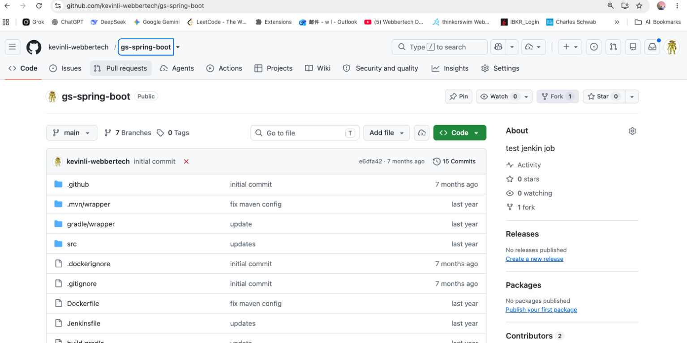

### Step 2: Check the Pull Requests tab

Go to the **Pull requests** tab. Before we start, there are no open pull requests.

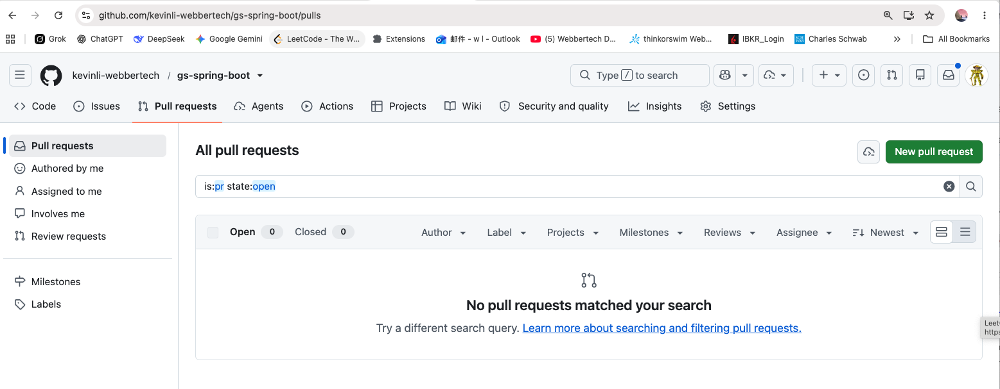

### Step 3: Compare changes between branches

Navigate to `<repo>/compare` (or click **New pull request**). This page lets you pick a `base` branch (the branch you want to merge **into**, usually `main`) and a `compare` branch (the branch you want to merge **from**). GitHub also shows example branch comparisons at the bottom of the page.

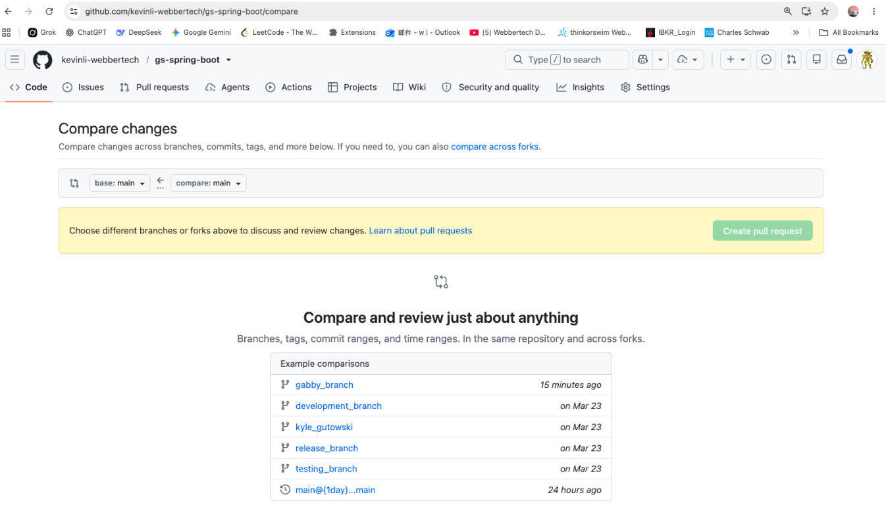

### Step 4: Pick the branch you want to merge

Set `compare` to the feature branch, `gabby_branch` in this example. GitHub shows:

* **Able to merge** - the two branches have no conflicts and can be merged automatically.
* A summary of commits, changed files, and contributors (here: 1 commit, 1 file changed, 1 contributor).
* The diff itself - here `testing.txt` was added.

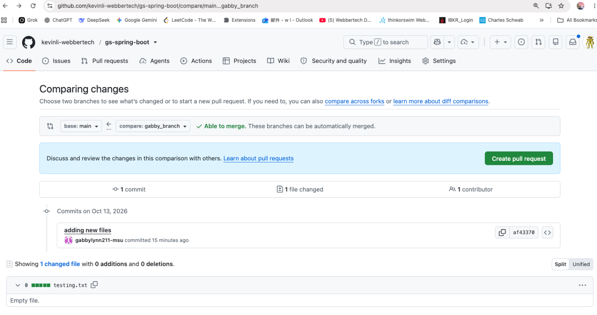

You can also open the **head ref** dropdown to switch which branch you are comparing against `main`:

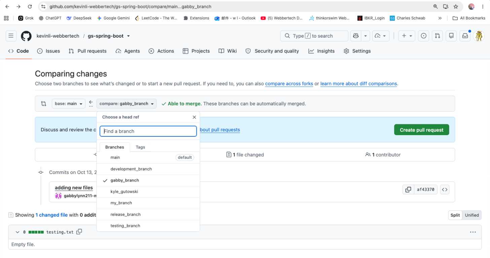

### Step 5: Open the pull request

Click **Create pull request**. GitHub pre-fills a title from the branch's commit message (editable), and gives you a description box. Note GitHub Copilot can also be requested as a reviewer directly from this page.

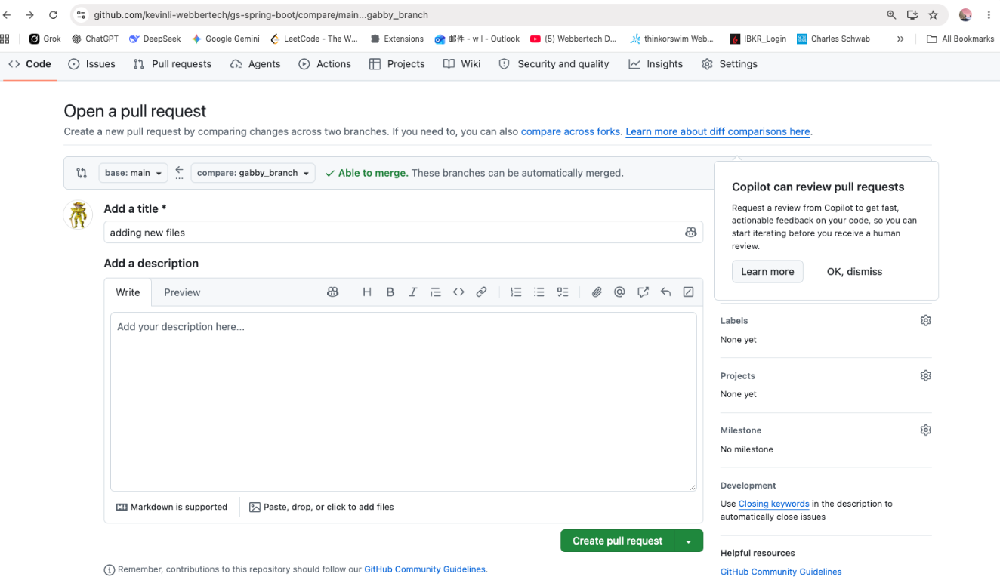

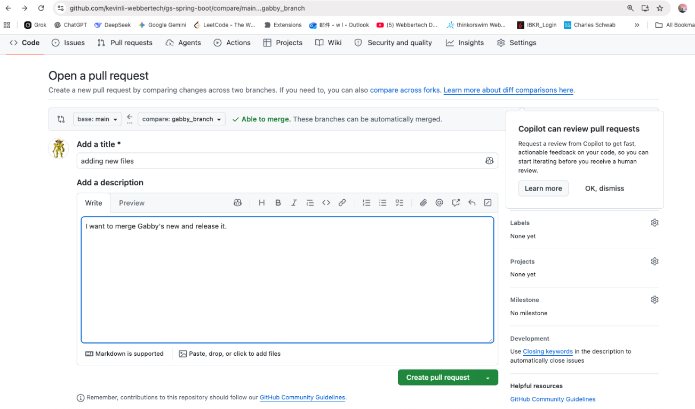

Add a clear description explaining **what** the change does and **why**:

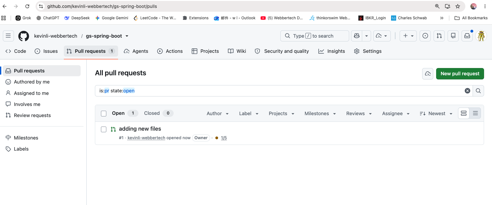

Click **Create pull request** to submit it. It now shows up under the **Pull requests** tab as an open PR:

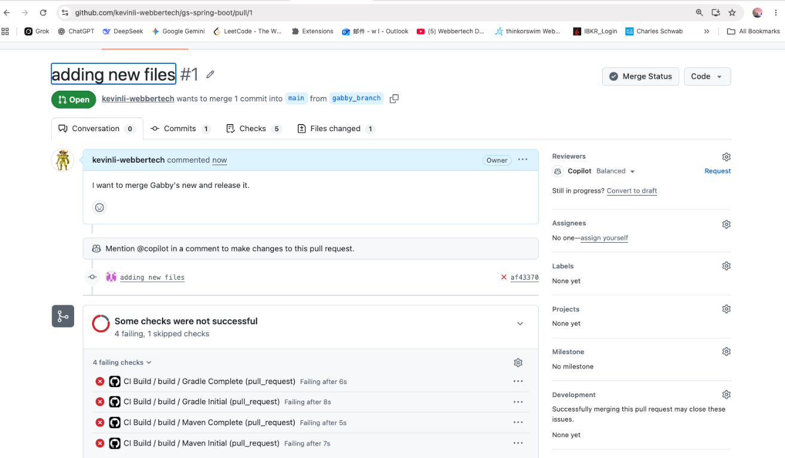

### Step 6: Review the pull request

Open the pull request to review:

* **Conversation** - the PR description and comments.
* **Commits** - the commit(s) being merged.
* **Checks** - CI/CD pipeline results (e.g., Jenkins, GitHub Actions). In this example, 4 CI checks failed and 1 was skipped - this is exactly what you want to catch **before** merging.
* **Files changed** - the actual diff.

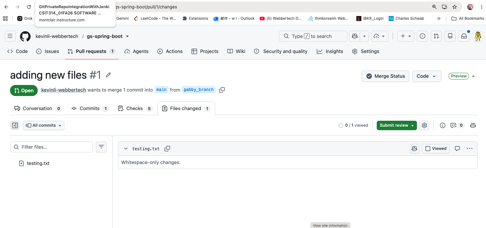

The **Files changed** tab shows exactly what will be merged - here, a new (empty) `testing.txt` file:

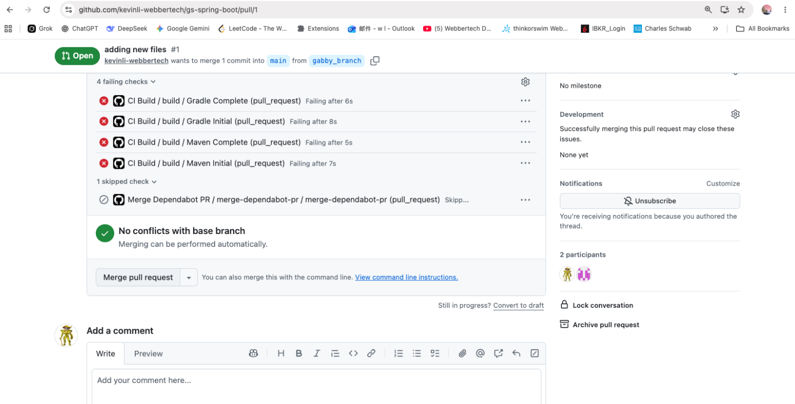

> **Note:** In real projects you should treat failing checks as a blocker and fix the underlying issue (or the pipeline) before merging. This lab continues with the merge to demonstrate the full workflow, but normally you would request changes or push fixes to the branch first.

### Step 7: Merge the pull request

Scroll down on the PR page. If there are no merge conflicts, GitHub shows **No conflicts with base branch - Merging can be performed automatically**, and enables the **Merge pull request** button.

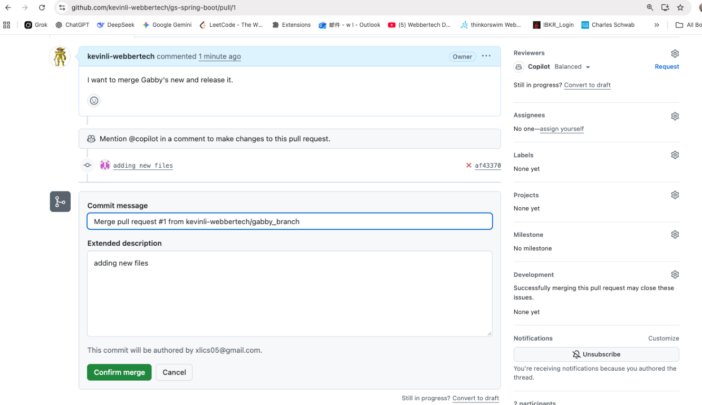

Clicking **Merge pull request** opens a confirmation dialog where you can edit the merge commit message and extended description before confirming:

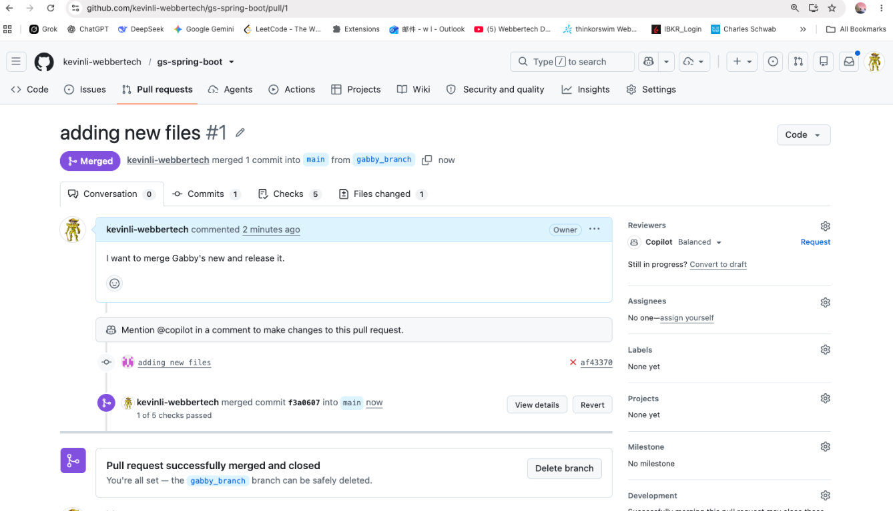

Click **Confirm merge**. The pull request is now marked **Merged**, and GitHub offers to delete the now-unneeded feature branch:

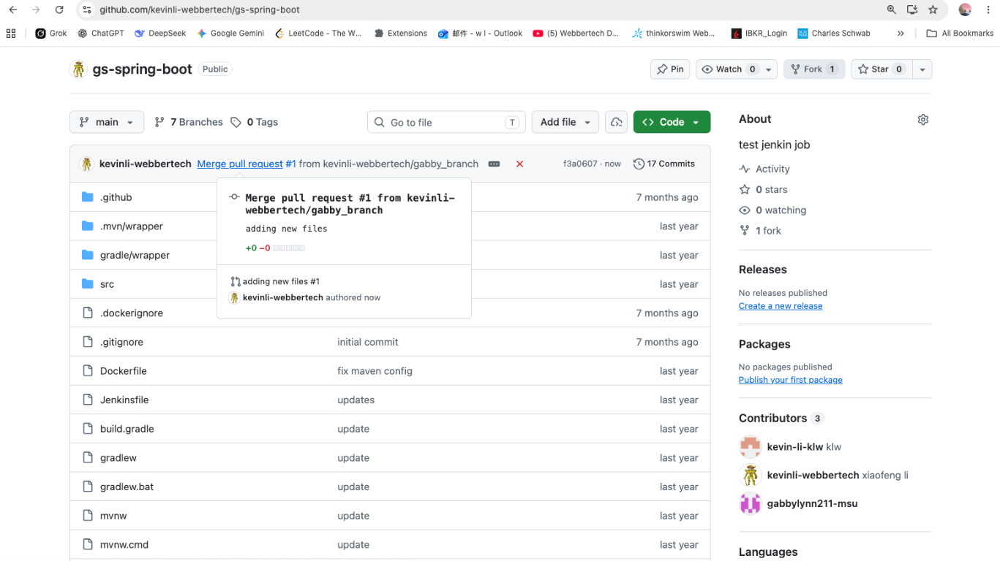

### Step 8: Verify the change on `main`

Back on the repository's **Code** tab, the latest commit is the merge commit (`Merge pull request #1 from <owner>/gabby_branch`), and the contributor who authored the feature branch now shows up in **Contributors**:

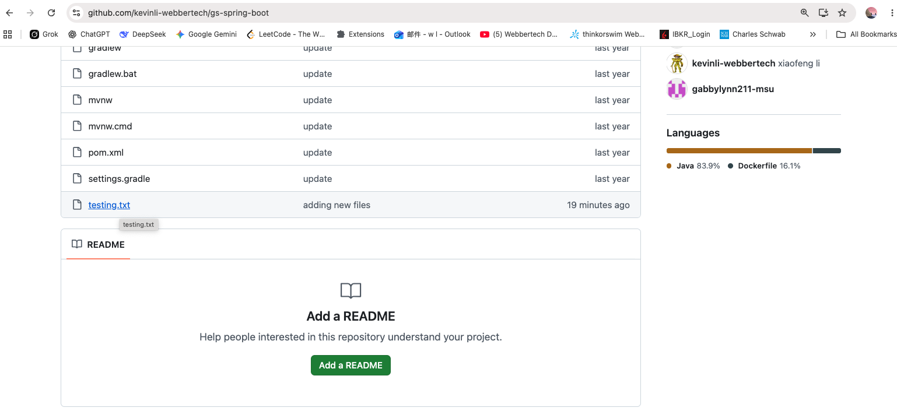

The merged file (`testing.txt`) is now part of `main`:

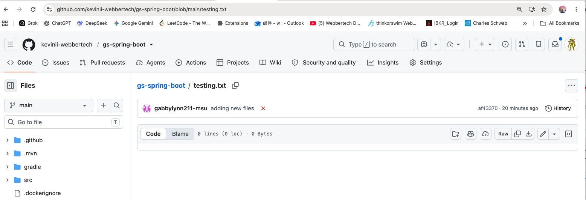

## Summary

| Step | Action |
|------|--------|
| 1 | Create/push a feature branch |
| 2 | Compare the feature branch against `main` |
| 3 | Open a pull request with a title and description |
| 4 | Review commits, CI checks, and the diff |
| 5 | Merge the pull request (resolve conflicts/failing checks first in real projects) |
| 6 | Delete the feature branch and verify `main` |

## Ref

- https://docs.github.com/en/pull-requests/collaborating-with-pull-requests/proposing-changes-to-your-work-with-pull-requests/creating-a-pull-request
- https://docs.github.com/en/pull-requests/collaborating-with-pull-requests/incorporating-changes-from-a-pull-request/merging-a-pull-request
