# Lab1: Git Branch Usages

## Goal

Get familiar with basic git commands: cloning a repo, creating and checking out branches,
committing changes, pushing a new branch to the remote, and inspecting branches and commit
history both from the command line and from the GitHub web UI.

## Labs

### Step 1: Checkout your git repo

Check out your git repo (we created it earlier when we built the Jenkins Pipeline job with a
Jenkinsfile).

```bash
bash-3.2$ git clone https://github.com/kevinli-webbertech/gs-spring-boot.git
```

### Step 2: Check your branches locally

Because you cloned the whole repo from the git server to your local machine, let's check what
branches exist locally.

```bash
bash-3.2$ git branch
* main
```

### Step 3: Create a local/development branch

```bash
bash-3.2$ git checkout -b my_branch
Switched to a new branch 'my_branch'
bash-3.2$ git branch
  main
* my_branch
```

### Step 4: Create a new file called Readme.md

```bash
bash-3.2$ git status
On branch my_branch
nothing to commit, working tree clean
bash-3.2$ touch Readme.md
```

### Step 5: Edit the Readme.md

Assume this is documentation or source code that we need to commit.

```bash
bash-3.2$ git status
On branch my_branch
Untracked files:
  (use "git add <file>..." to include in what will be committed)
        Readme.md
nothing added to commit but untracked files present (use "git add" to track)
bash-3.2$ vi Readme.md
bash-3.2$ git status
On branch my_branch
Untracked files:
  (use "git add <file>..." to include in what will be committed)
        Readme.md
nothing added to commit but untracked files present (use "git add" to track)
bash-3.2$ git add Readme.md
bash-3.2$ git status
On branch my_branch
Changes to be committed:
  (use "git reset HEAD <file>..." to unstage)
        new file:   Readme.md
bash-3.2$ git commit -m "add a readme file"
[my_branch 864e332] add a readme file
 1 file changed, 9 insertions(+)
 create mode 100644 Readme.md
```

Now `git status` does not tell you anything beyond this point once you've committed all the new
files successfully, but it will tell you about anything that is not committed, so called "not
tracked".

```bash
bash-3.2$ git status
On branch my_branch
nothing to commit, working tree clean
```

### Step 6: Git push

Now let's try to push the new branch with the new changes to the remote server. If you do that,
you will see the following:

```bash
bash-3.2$ git push
fatal: The current branch my_branch has no upstream branch.
To push the current branch and set the remote as upstream, use

    git push --set-upstream origin my_branch
```

Copy the suggested command from the message above and execute it. You will then see the new
branch created locally get pushed to the remote server — the server now has it too.

```bash
bash-3.2$ git push --set-upstream origin my_branch
Enumerating objects: 4, done.
Counting objects: 100% (4/4), done.
Delta compression using up to 12 threads
Compressing objects: 100% (3/3), done.
Writing objects: 100% (3/3), 366 bytes | 366.00 KiB/s, done.
Total 3 (delta 1), reused 0 (delta 0)
remote: Resolving deltas: 100% (1/1), completed with 1 local object.
remote:
remote: Create a pull request for 'my_branch' on GitHub by visiting:
remote:      https://github.com/kevinli-webbertech/gs-spring-boot/pull/new/my_branch
remote:
To https://github.com/kevinli-webbertech/gs-spring-boot.git
 * [new branch]      my_branch -> my_branch
Branch 'my_branch' set up to track remote branch 'my_branch' from 'origin'.
```

### Step 7: Check the new branch in both the remote git server and locally

There are two ways to check whether your branch was successfully pushed to the remote git
server:

* Go to the web page of git and check the new branch there.
* Run a command in your local command line — no need to open a browser tab and click around.

If we type the following command, it only shows our local branches, not the remote branches:

```bash
bash-3.2$ git branch
  main
* my_branch
```

If somehow I removed some local branches, that would not affect the git server's repo branches,
unless I also delete the remote branches.

So now let's delete the local branch after we've pushed it.

```bash
bash-3.2$ git branch
  main
* my_branch
bash-3.2$ git branch -d my_branch
error: Cannot delete branch 'my_branch' checked out at '/Users/xiaofengli/code/gs-spring-boot'
```

As we can see above, I am currently on `my_branch`, so I cannot delete it. If I really want to
delete it, I have to switch to another branch first.

```bash
bash-3.2$ git checkout main
Switched to branch 'main'
Your branch is up to date with 'origin/main'.
```

Now we are able to delete the previous branch.

```bash
bash-3.2$ git branch -d my_branch
warning: deleting branch 'my_branch' that has been merged to
         'refs/remotes/origin/my_branch', but not yet merged to HEAD.
Deleted branch my_branch (was 864e332).
```

Now check the local branches again, and it is no longer there.

```bash
bash-3.2$ git branch
* main
```

**Solution 2**

How do we check what remote branches exist in the remote git server repo using a command?

```bash
bash-3.2$ git branch -r
  origin/HEAD -> origin/main
  origin/main
  origin/my_branch
```

Now we can see `origin/my_branch` in the output above — that is our remote branch that we just
pushed.

Since we no longer have a local branch on our own computer (sometimes at work I mistakenly get
rid of my own personal branch and really want it back), we can also check out a remote branch to
local.

For instance, now I want to check out `my_branch` back to my local machine from the remote
server:

```bash
bash-3.2$ git checkout my_branch
Branch 'my_branch' set up to track remote branch 'my_branch' from 'origin'.
Switched to a new branch 'my_branch'
```

Now let's check our local branches again, and we can see our branch came back.

```bash
bash-3.2$ git branch
  main
* my_branch
```

### Switching branches

So far we have used `git checkout` in three different ways. Here is a summary:

| Command | What it does |
|---------|--------------|
| `git checkout -b new_branch` | **Create** `new_branch` from the current commit and switch to it (as in Step 3, `git checkout -b my_branch`). |
| `git checkout main` | **Switch** to a branch that already exists locally. |
| `git checkout my_branch` | If no local `my_branch` exists but `origin/my_branch` does, Git creates a local branch that tracks the remote one, then switches to it (as shown above). |

Note that `-b` means "create". Without `-b`, `git checkout <name>` only switches. If you mistype
a branch name without `-b`, Git will tell you the branch does not exist instead of creating it.

Try it yourself:

```bash
bash-3.2$ git checkout -b new_branch      # create and switch
Switched to a new branch 'new_branch'
bash-3.2$ git checkout main               # switch back to main
Switched to branch 'main'
bash-3.2$ git checkout -                  # jump back to the previous branch
Switched to branch 'new_branch'
bash-3.2$ git branch                      # the * marks the current branch
  main
  my_branch
* new_branch
```

Each branch has its own history, and the files in your working directory change to match the
branch you switch to. For example, the `Readme.md` changes we committed on `my_branch` will not
appear on `main` until the branch is merged.

**Switching with uncommitted changes**

Git tries to carry your uncommitted changes over to the branch you switch to. If those changes
would conflict with the target branch, Git refuses to switch:

```bash
bash-3.2$ git checkout main
error: Your local changes to the following files would be overwritten by checkout:
        Readme.md
Please commit your changes or stash them before you switch branches.
Aborting
```

You have two options:

* Commit your work first (`git add` and `git commit`), then switch.
* Temporarily set it aside with `git stash`, switch branches, and later bring it back with
  `git stash pop`.

**`git switch` (newer alternative)**

Since Git 2.23, there are two commands that split up what `git checkout` does. `git switch` is for
changing branches, and `git restore` is for restoring files. They do the same branch work as above:

| Old | New |
|-----|-----|
| `git checkout main` | `git switch main` |
| `git checkout -b new_branch` | `git switch -c new_branch` |
| `git checkout -` | `git switch -` |

Both styles work. This lab uses `git checkout` because it is still very common in tutorials,
scripts and older documentation. Run `git --version` to check whether your Git supports `git switch`.

And for reference, the full `git branch` help output:

```bash
bash-3.2$ git branch -h
usage: git branch [<options>] [-r | -a] [--merged | --no-merged]
   or: git branch [<options>] [-l] [-f] <branch-name> [<start-point>]
   or: git branch [<options>] [-r] (-d | -D) <branch-name>...
   or: git branch [<options>] (-m | -M) [<old-branch>] <new-branch>
   or: git branch [<options>] (-c | -C) [<old-branch>] <new-branch>
   or: git branch [<options>] [-r | -a] [--points-at]
   or: git branch [<options>] [-r | -a] [--format]

Generic options
    -v, --verbose         show hash and subject, give twice for upstream branch
    -q, --quiet           suppress informational messages
    -t, --track           set up tracking mode (see git-pull(1))
    -u, --set-upstream-to <upstream>
                          change the upstream info
    --unset-upstream      Unset the upstream info
    --color[=<when>]      use colored output
    -r, --remotes         act on remote-tracking branches
    --contains <commit>   print only branches that contain the commit
    --no-contains <commit>
                          print only branches that don't contain the commit
    --abbrev[=<n>]        use <n> digits to display SHA-1s

Specific git-branch actions:
    -a, --all             list both remote-tracking and local branches
    -d, --delete          delete fully merged branch
    -D                    delete branch (even if not merged)
    -m, --move            move/rename a branch and its reflog
    -M                    move/rename a branch, even if target exists
    -c, --copy            copy a branch and its reflog
    -C                    copy a branch, even if target exists
    -l, --list            list branch names
    --create-reflog       create the branch's reflog
    --edit-description    edit the description for the branch
    -f, --force           force creation, move/rename, deletion
    --merged <commit>     print only branches that are merged
    --no-merged <commit>  print only branches that are not merged
    --column[=<style>]    list branches in columns
    --sort <key>          field name to sort on
    --points-at <object>  print only branches of the object
    -i, --ignore-case     sorting and filtering are case insensitive
    --format <format>     format to use for the output
```

In Linux/Unix, `-h` will show you help, and a single dash with one letter is usually a shorthand
for the double-dash full word version. For example, `-r` means `--remotes`.

```bash
bash-3.2$ git branch --remote
  origin/HEAD -> origin/main
  origin/main
  origin/my_branch
bash-3.2$ git branch --remotes
  origin/HEAD -> origin/main
  origin/main
  origin/my_branch
```

**Solution 2 (web UI)**

Let's check the branch on the web UI. Please see the yellow banner below, then check the
drop-down menu:

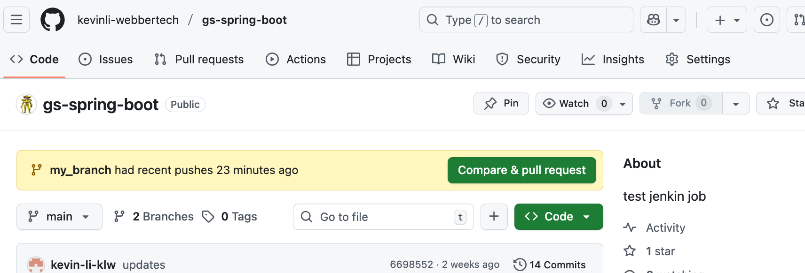

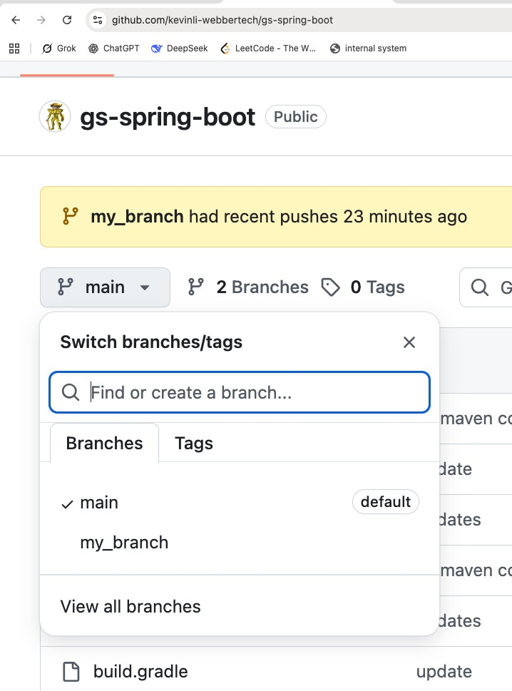

Now let's check the new file we added:

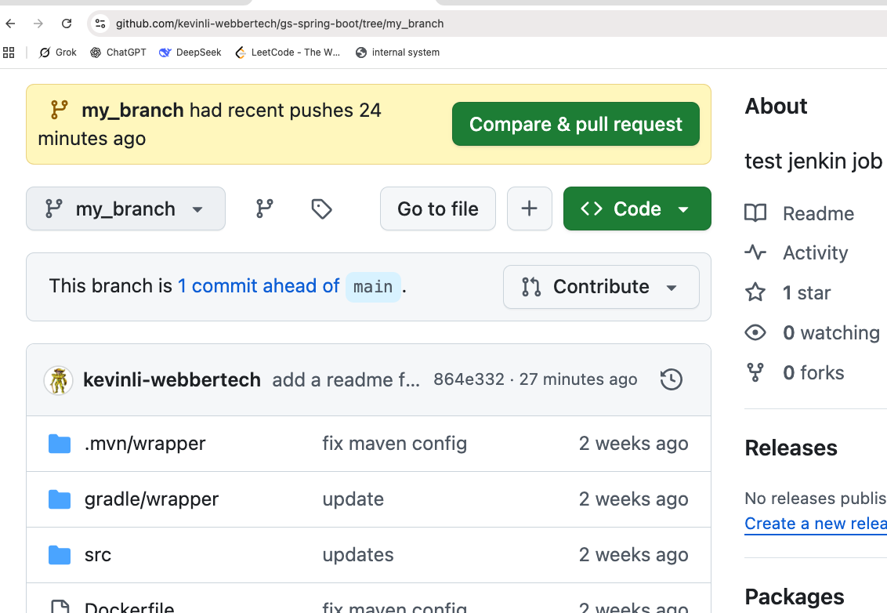

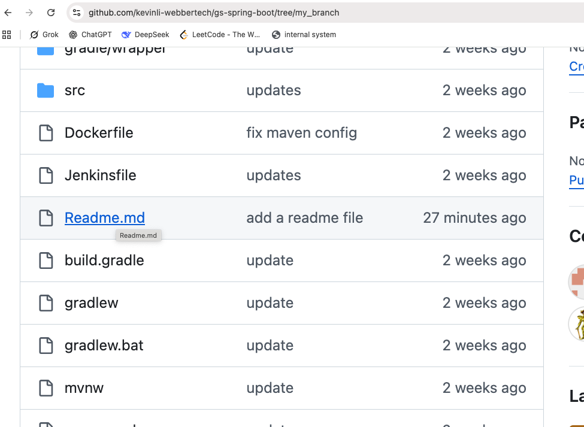

Click on `Readme.md`, which is a markdown file. **Markdown** is actually similar to a **Markup**
Language like HTML. We use markdown on this course site, so it converts into HTML without writing
a whole bunch of code — writing markdown is just like a word document, but with a lot of
annotations to render and support the writing without HTML tagging libraries.

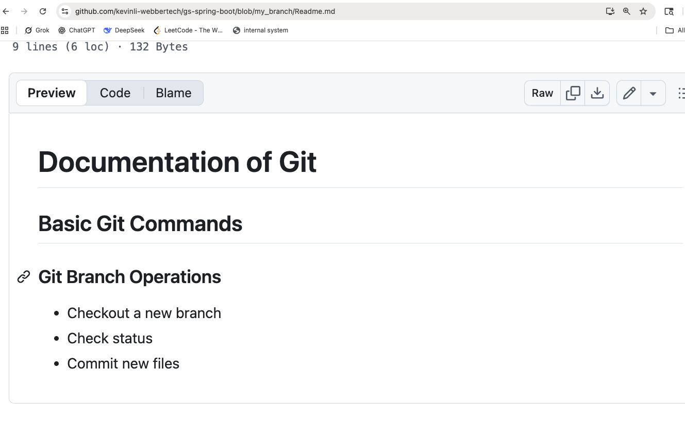

Click on the **Edit** button:

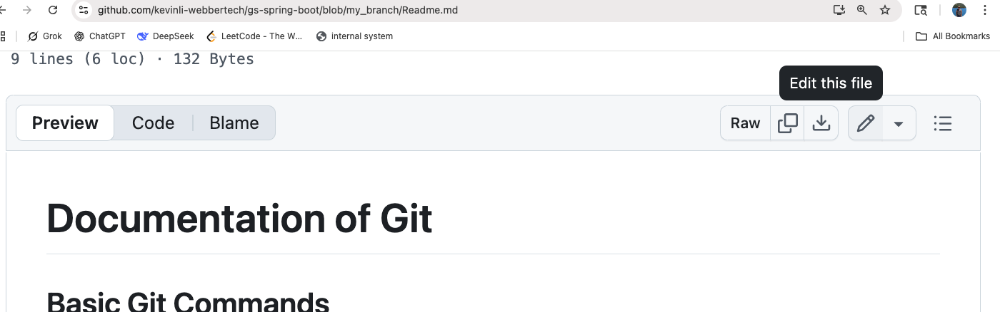

Keep editing and adding new content:

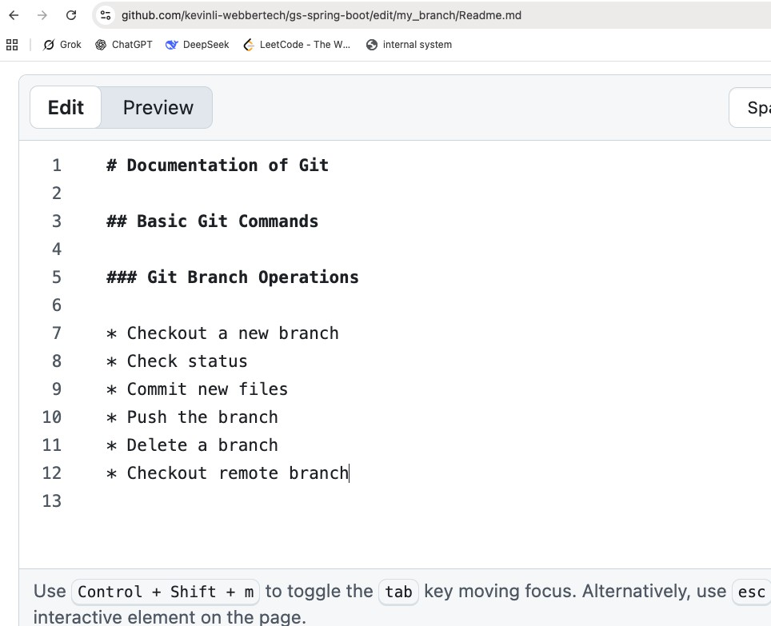

Once you are done, do a Ctrl/Cmd + S to save the file, and you will see this — hit the green
button above:

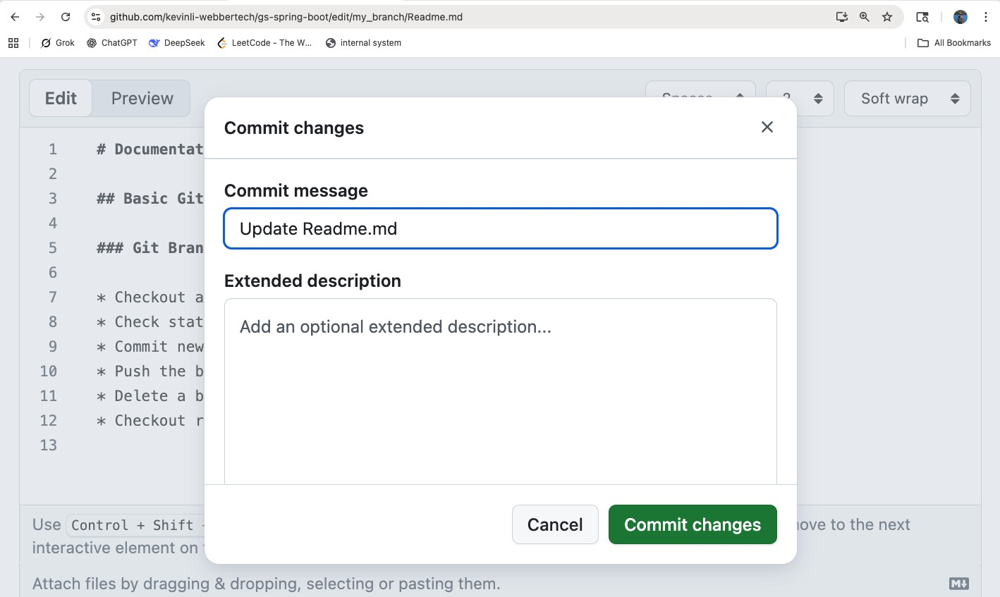

After you save it, please check the following:

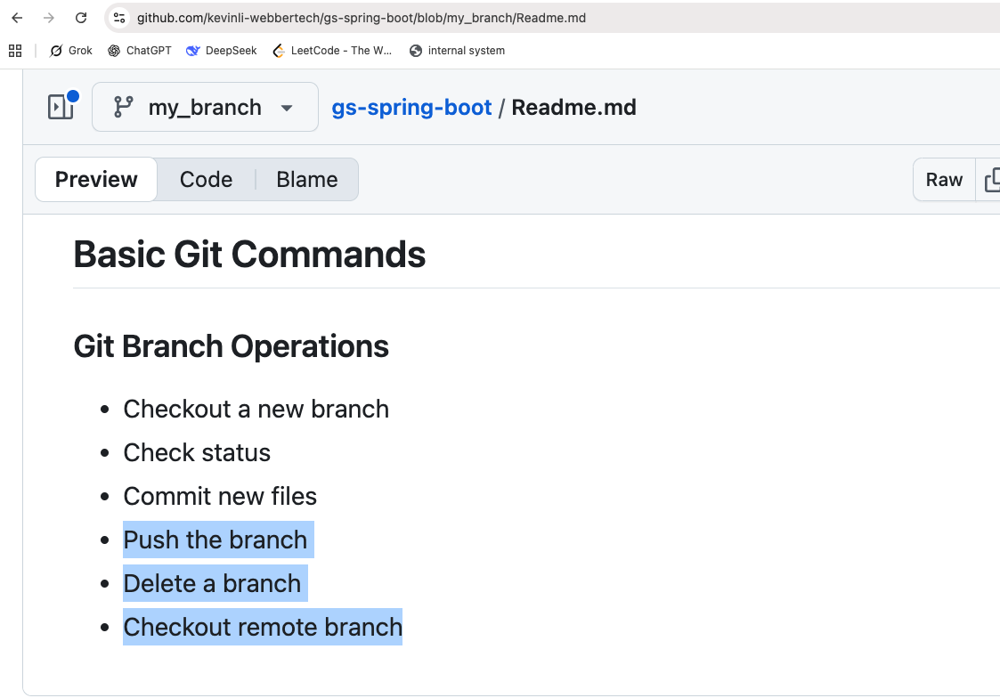

Next, let's check all the commits we made:

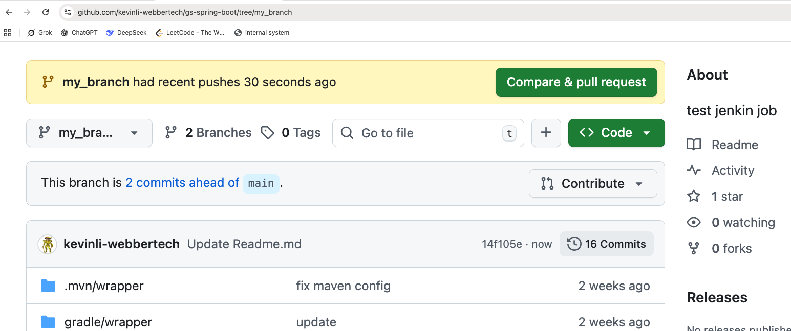

In the image above, let's click on the commit count badge:

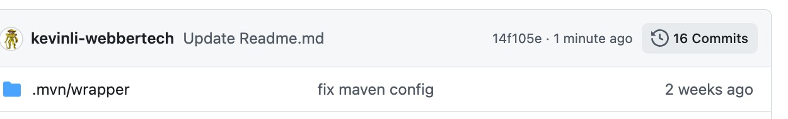

Now we can see the following commit hashes:

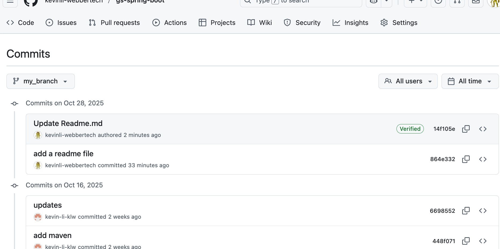

For instance, click on the hash below:

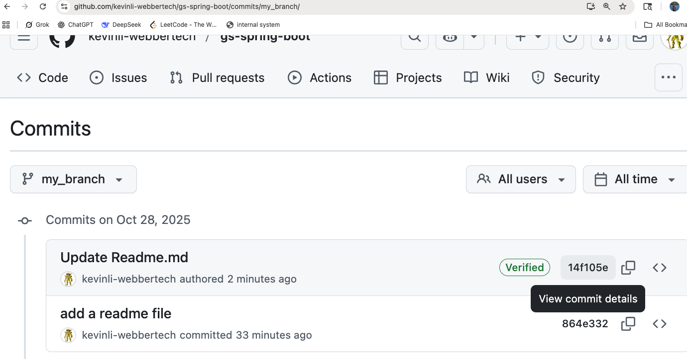

Then you click on the hash:

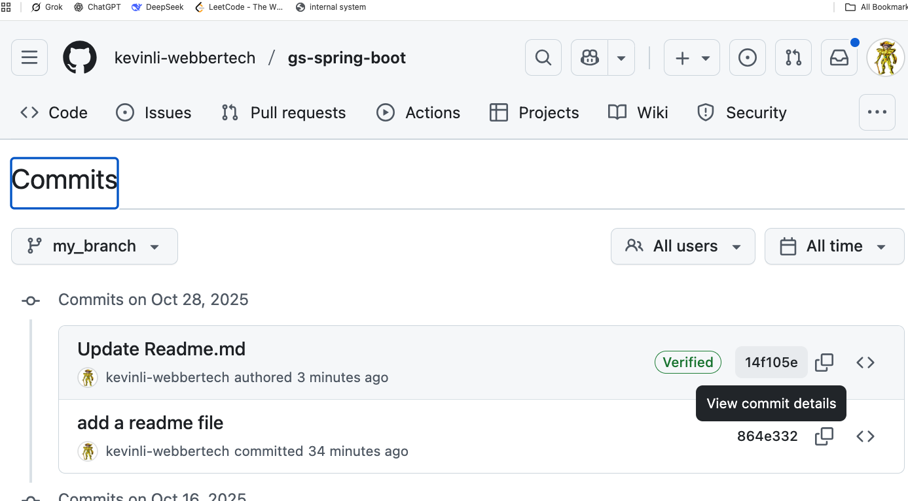

In the next view, you can see a diff of the previous edits versus the latest edits:

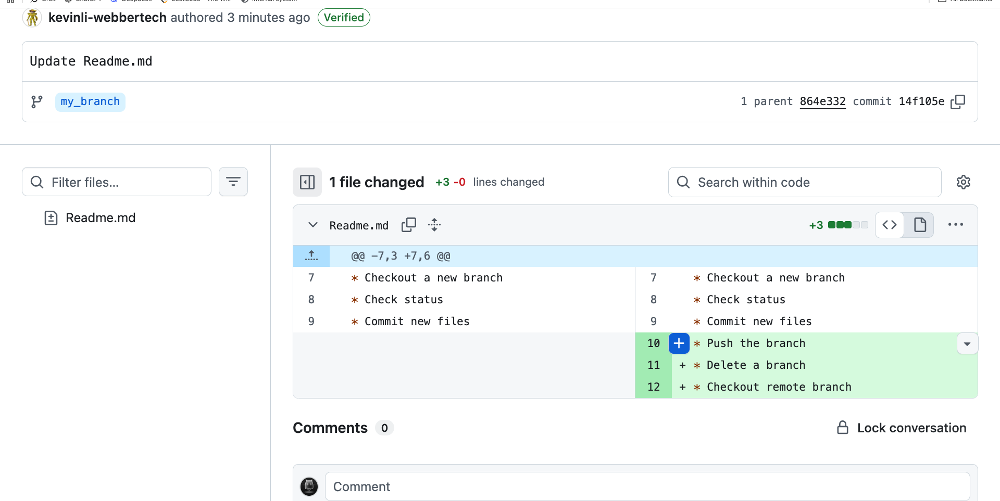

## Lab Document

- https://kevinli-webbertech.github.io/blog/md/courses/dev_ops/github/labs/Git_Basics_Lab1.pdf
