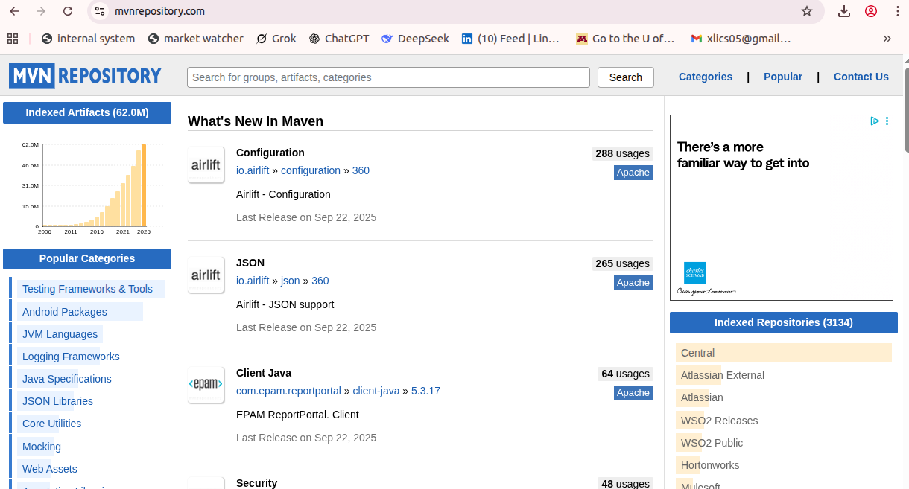
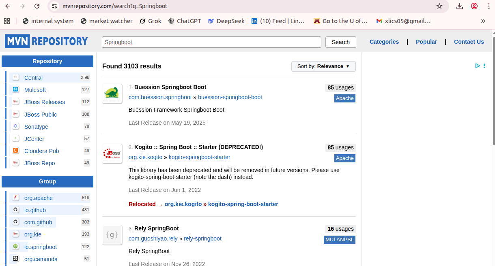
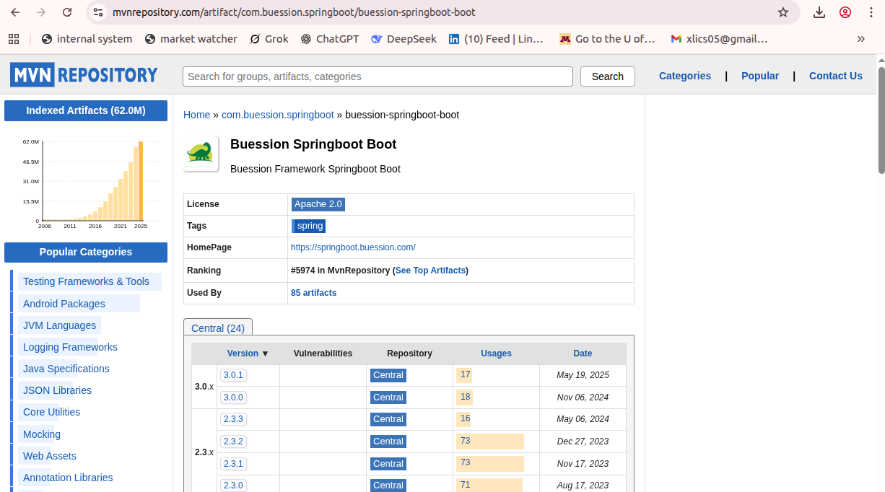
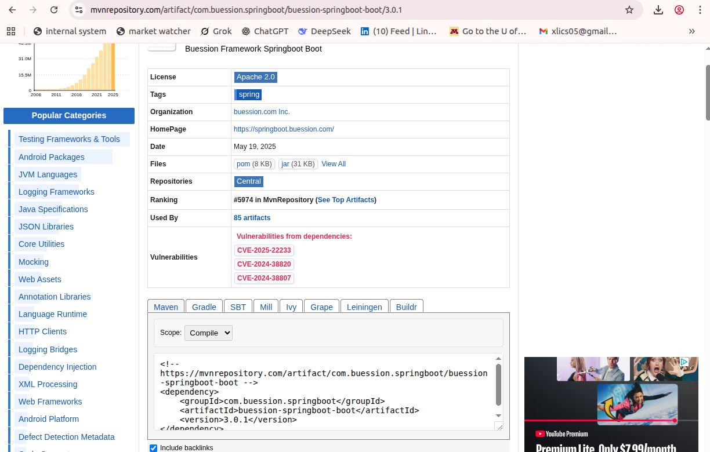

# Introduction to Nexus Repository Manager

## What is Nexus?

Nexus Repository Manager (often just called Nexus) is a powerful tool that helps developers and organizations store, manage, and distribute software artifacts.
Think of it as a "library" for your software components—whether they are Java JAR files, Python packages, Docker images, npm modules, or any other type of build dependency.

## Key Concepts You Should Know

1. What is a Repository?

A repository (or repo) is like a folder where Nexus stores different types of software:

- Proxy Repositories – Cache files from public sources (e.g., Maven Central).

- Hosted Repositories – Store your private/internal libraries.

- Group Repositories – Combine multiple repos into one for easier access.

**Example** 

* https://mvnrepository.com/



For example, if I search `springboot` library, it is here,



Once you click in the first item, and it looks like this,



another image,



2. What Are Artifacts?

An artifact is any file stored in Nexus—like a .jar (Java), .whl (Python), .tgz (npm), or .deb (Linux packages).

3. What is Docker’s Role Here?

Nexus can also store Docker images, making it a private alternative to Docker Hub.

## Why do you need Nexus?

1. Dependency Management – Instead of downloading libraries directly from the internet every time (which can be slow and unreliable), Nexus stores them locally for faster, more reliable builds.

2. Proxy & Caching – Nexus can act as a middleman between your team and public repositories (like Maven Central, npm, PyPI). It caches downloaded files so future requests are faster.

3. Private Repositories – You can host your own internal libraries securely, ensuring only authorized users can access them.

4. Build Consistency – By controlling which versions of dependencies are available, Nexus helps prevent unexpected breaks in your software.

5. Security & Compliance – Nexus can scan for vulnerabilities in dependencies and enforce policies (e.g., blocking unsafe versions).

## Types of Repositories inside of Nexus

- Nexus supports multiple repository formats, including:

- Maven (Java) – For JARs, WARs, and other Java artifacts.

- npm (JavaScript) – For Node.js packages.

- Docker – For container images.

- PyPI (Python) – For Python packages.

- Raw – For generic file storage (e.g., installers, scripts).

- And many more

## Installation Guide

### Step 1: Update System and Install Docker


Run docker,


### Commands Used

- sudo apt update
- sudo apt install -y docker.io
- sudo systemctl enable docker
- sudo systemctl start docker

### Commands Explained

- (sudo apt install -y docker.io) installs Docker from the default Ubuntu repositories. -y automatically says "yes" to prompts.

- (sudo systemctl enable docker) configures Docker to start automatically at boot.

- (sudo systemctl start docker) starts the Docker service right now so you can use it immediately.

## Step 2: Add Your User to Docker Group (avoid sudo every time)


### Commands Used

- sudo usermod -aG docker $USER
- newgrp docker 

### Commands Explained

- (sudo usermod -aG docker $USER) adds your user to the docker group so you can run Docker commands without sudo.

- (newgrp docker) applies the group change in your current terminal session immediately. Otherwise, you'd have to log out and back in.

## Step 3: Run Nexus Container

### (Optional) Create the data volume first

The `-v nexus-data:/nexus-data` option in the command below uses a Docker **named volume**. Docker creates it automatically the first time you run the command, so you do not have to create anything yourself. If you would like to see it, or create it explicitly beforehand, use:

```
docker volume create nexus-data
docker volume ls
docker volume inspect nexus-data
```

`docker volume inspect` shows where Docker keeps the data on the host (`Mountpoint`). It is managed by Docker, so you do not need to make a folder.

> If you would rather mount a normal folder on your machine (a *bind mount*, for example `-v $(pwd)/nexus-data:/nexus-data`), then you do have to create the folder first (`mkdir nexus-data`), and it must be writable by the user inside the container, otherwise Nexus will fail to start. The Sonatype image documentation says to give it to user id 200 (`sudo chown -R 200 nexus-data`). The named volume above avoids this.

### Run the container


```
docker run -d -p 8081:8081 --name nexus \
  -v nexus-data:/nexus-data \
  sonatype/nexus3
```

(This runs Nexus in a container and stores data in a persistent Docker volume nexus-data)

Nexus takes a while to start up (often a minute or more). Check that the container is up with `docker ps`, and watch it start with `docker logs -f nexus` (press Ctrl+C to stop following). Wait until you see `Started Sonatype Nexus` before continuing.

### Commands Explained

- docker run: Tells Docker to start a new container.

- -d: Detached mode — runs in the background.

- -p 8081:8081: Maps port 8081 on your machine to port 8081 inside the container. This is how you access the Nexus UI in your browser.

- --name nexus: Names your container "nexus" so you can refer to it easily later.

- -v nexus-data:/nexus-data: Creates and mounts a Docker volume named nexus-data to persist Nexus data (like configuration, repos, etc.) even if the container is deleted.

- sonatype/nexus3: The Docker image from [Docker Hub](https://hub.docker.com/r/sonatype/nexus3) — this pulls the official open-source Nexus Repository Manager 3 image.

## Step 4: Access Nexus Web UI

Open a browser and go to,

http://localhost:8081


## Step 5: Get the Admin Password

Use the following command,

`docker exec -it nexus cat /nexus-data/admin.password`


### Commands Explained

- docker exec: Runs a command inside a running container.

- -it: Interactive + TTY, lets you interact as if in a terminal.

- nexus: The name of the container.

- cat /nexus-data/admin.password: Outputs the initial password file generated by Nexus.

### If the admin.password file is not there

You will see `No such file or directory` if the file does not exist. The usual reasons are:

- **Nexus has not finished starting.** The file is only written once Nexus has started for the first time. Wait for `Started Sonatype Nexus` in `docker logs nexus`, then run the command again.
- **The initial password was already changed.** Nexus removes the file once the admin password has been changed (for example after you finish the first-login wizard). From then on, log in with the password you chose.
- **You re-used an old volume.** If `nexus-data` was left over from an earlier container, it already holds the old setup, so there is no new initial password. If you do not need the old data and want a fresh start, remove the container and volume, then run Step 3 again (**this deletes everything stored in Nexus**):

```
docker rm -f nexus
docker volume rm nexus-data
```

- **Wrong container name.** The command uses the container name `nexus`. Check it with `docker ps`.

## Step 6: Log In to Nexus UI

Click the top right corner of your avatar,


Then the username of "admin" and its password to login,


### Remember

- Username: admin
- Password: (paste the value you got from the step above)

You'll be prompted to change the password after you log in.


Then click browse, and you will see the following,


## Debugging

If your container failed to start and you would like to see what errors cause it to fail, you can use the following commands,

`bash-3.2$ docker logs -f 6af3de7472b622697ad5eed291d398f0db3dfaf0be0b018ce2bfd2c46c89008d`


*Explanation:*

The hash above is the container id.