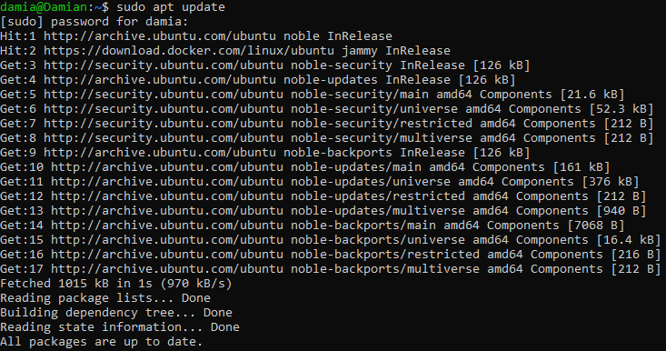
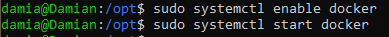
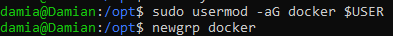
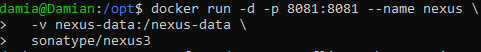
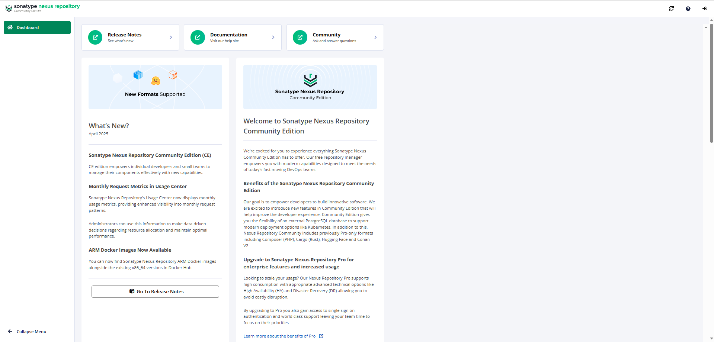
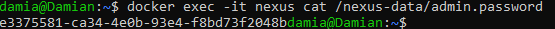
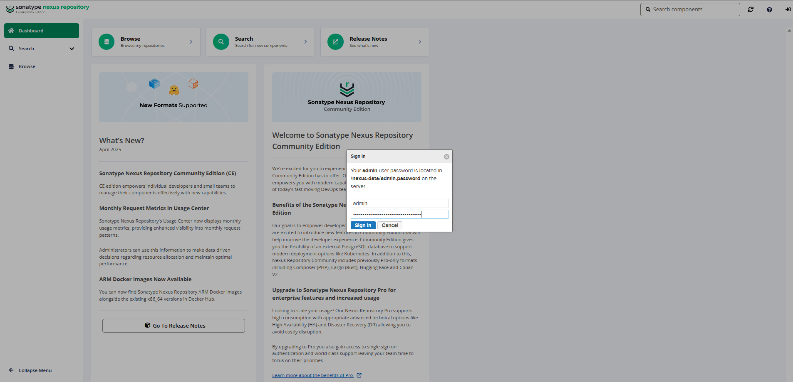
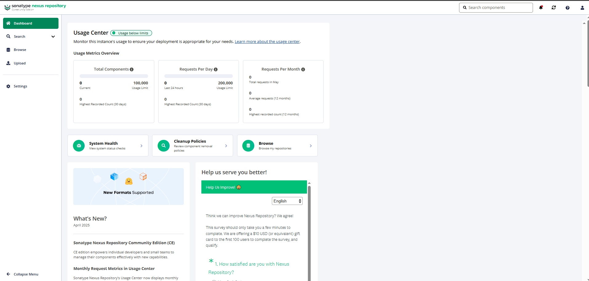
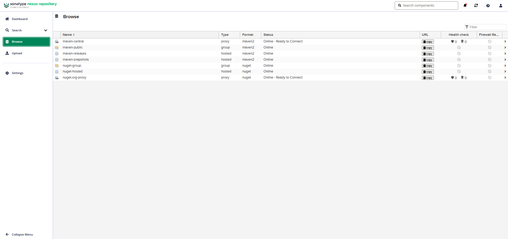

# Nexus Introduction

## Installation

## Step 1: Update System and Install Docker

### Commands Used:

- sudo apt update



- sudo apt install -y docker.io


- sudo systemctl enable docker
- sudo systemctl start docker



### Commands Explained:

- (sudo apt install -y docker.io) Installs Docker from the default Ubuntu repositories. The -y flag automatically confirms prompts with "yes".

- (sudo systemctl enable docker) Configures Docker to start automatically at boot.

- (sudo systemctl start docker) Starts the Docker service immediately so you can use it right away.

## Step 2: Add Your User to Docker Group (avoid sudo every time)

### Commands Used:

```sudo usermod -aG docker $USER
newgrp docker 
```



### Commands Explained:

- (sudo usermod -aG docker $USER) Adds your user to the docker group so you can run Docker commands without sudo.

- (newgrp docker) Applies the group change in your current terminal session immediately. Otherwise, you'd have to log out and back in.

## Step 3: Run Nexus Container



### Commands Used:

The `-v nexus-data:/nexus-data` option uses a Docker **named volume**. Docker creates it automatically on the first run, so there is no folder to create. To create or inspect it yourself: `docker volume create nexus-data`, `docker volume ls`, `docker volume inspect nexus-data`. (If you use a bind-mounted folder instead, create it first and make it writable by user id 200, e.g. `sudo chown -R 200 nexus-data`.)

```
docker run -d -p 8081:8081 --name nexus \
  -v nexus-data:/nexus-data \
  sonatype/nexus3
```

(This runs Nexus in a container and stores data in a persistent Docker volume nexus-data)

Nexus takes a while to start (often a minute or more). Check `docker ps`, and wait for `Started Sonatype Nexus` in `docker logs -f nexus` (Ctrl+C to stop following) before moving on.

### Commands Explained:

- docker run: Tells Docker to start a new container.

- -d: Detached mode — runs in the background.

- -p 8081:8081: Maps port 8081 on your machine to port 8081 inside the container. This is how you access the Nexus UI in your browser.

- --name nexus: Names your container "nexus" so you can refer to it easily later.

- -v nexus-data:/nexus-data: Creates and mounts a Docker volume named nexus-data to persist Nexus data (like configuration, repos, etc.) even if the container is deleted.

- sonatype/nexus3: The Docker image from [Docker Hub](https://hub.docker.com/r/sonatype/nexus3) — this pulls the official open-source Nexus Repository Manager 3 image.

## Step 4: Access Nexus Web UI

Open a browser and go to :

`http://localhost:8081`



## Step 5: Get the Admin Password



### Commands Used:

`docker exec -it nexus cat /nexus-data/admin.password`

### Commands Explained:

- docker exec: Runs a command inside a running container.

- -it: Interactive + TTY, lets you interact as if in a terminal.

- nexus: The name of the container.

- cat /nexus-data/admin.password: Outputs the initial password file generated by Nexus.

If you get `No such file or directory`: Nexus may not have finished starting (wait for `Started Sonatype Nexus` in `docker logs nexus`); the password was already changed (Nexus removes the file after that); an old `nexus-data` volume was re-used (for a fresh start, `docker rm -f nexus` and `docker volume rm nexus-data`, which deletes all Nexus data, then run Step 3 again); or the container name is not `nexus` (check `docker ps`).

## Step 6: Log In to Nexus UI



### Remember:

- Username: admin
- Password: (paste the value you got from the step above)

You'll be prompted to change the password after you log in.



