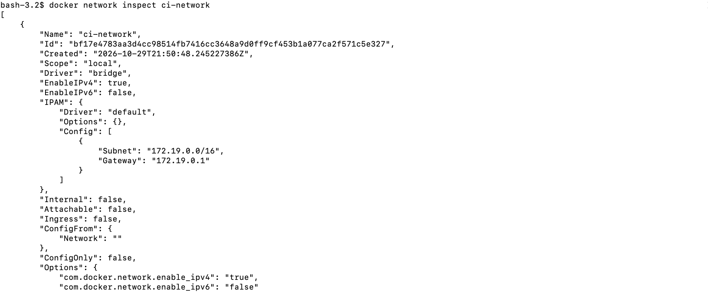
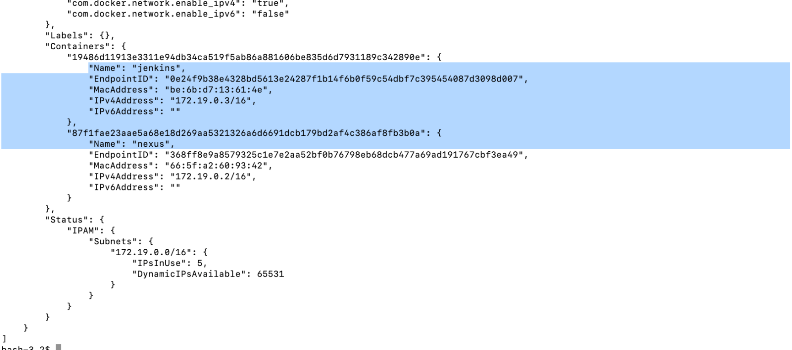
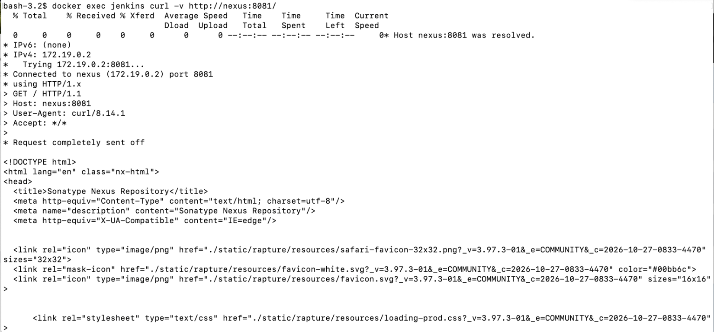
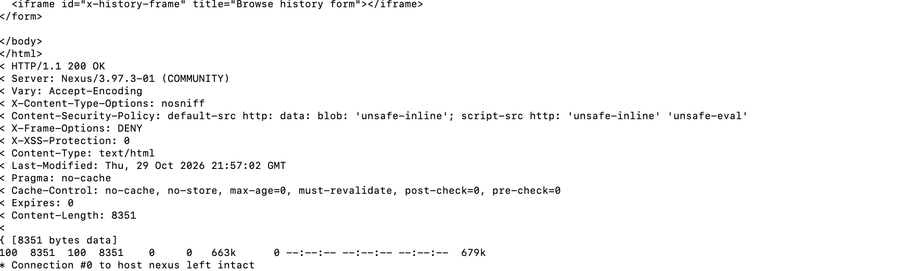

# Nexus Lab2: Jenkins Integration — Build a Jar and Push It to Nexus

Written by: Kevin Li

## Goal

Lab1 uploaded a jar to Nexus by hand through the web UI. This lab automates that step: a
Jenkins pipeline checks out the `gs-spring-boot` project, builds the jar with Maven, and
publishes it to a local Nexus Maven repository with `mvn deploy`.

Reference project: [https://github.com/kevinli-webbertech/gs-spring-boot](https://github.com/kevinli-webbertech/gs-spring-boot)
(`groupId: com.example`, `artifactId: spring-boot-complete`, `version: 0.0.1-SNAPSHOT`).

### Knowledge

* Maven's `distributionManagement` section tells `mvn deploy` which remote repository to
  publish to, for release versions and for `-SNAPSHOT` versions respectively.
* Maven does **not** accept `-Dusername`/`-Dpassword` on the command line to authenticate a
  deploy. Credentials must come from a `<server>` entry in `settings.xml` whose `id` matches
  the repository id used in `distributionManagement` (or on `-DrepositoryId` for
  `deploy:deploy-file`). A Jenkins pipeline can generate that `settings.xml` on the fly from a
  Jenkins credential, so nothing secret is stored in the repo.
* Because `com.example:spring-boot-complete` is currently `0.0.1-SNAPSHOT`, Maven routes the
  deploy to the **snapshot** repository, not the release one.

## Labs

### Step 1: Start the Jenkins Service (Docker)

If you don't already have a Jenkins container running, start one the same way as in
[Intro to Jenkins](../../jenkins/intro_jenkins.md):

`docker run -p 8080:8080 -p 50000:50000 --name jenkins jenkins/jenkins:lts`

* Port `8080` serves the Jenkins web UI; port `50000` is used for inbound Jenkins agents.
* Get the initial admin password from the container logs, or with:

```cmd
docker exec jenkins cat /var/jenkins_home/secrets/initialAdminPassword
```

* Browse to `http://localhost:8080`, enter that password, and finish the setup wizard.

> Note: `--name jenkins` is added so the container can be referenced by name later (Step 4, when
> we put Jenkins and Nexus on the same Docker network).

Documentation: [https://github.com/jenkinsci/docker/blob/master/README.md](https://github.com/jenkinsci/docker/blob/master/README.md)

### Step 2: Start Jenkins on a Different Port (Optional)

Port `8080` is a common default and may already be in use (by another app, or if you want to
run a second Jenkins instance alongside an existing one). Map a different **host** port to the
container's internal `8080` instead:

`docker run -p 8082:8080 -p 50000:50000 jenkins/jenkins:lts`

* Only the first number (the host port, left of the colon) changes — the container still
  listens on `8080` internally, so the setup steps above are otherwise identical.
* Use a distinct container name if both instances run at once, e.g.
  `docker run -p 8082:8080 -p 50000:50000 --name jenkins-alt jenkins/jenkins:lts`.
* Get the admin password the same way, substituting the new container name/id:

```cmd
docker exec jenkins-alt cat /var/jenkins_home/secrets/initialAdminPassword
```

* Browse to `http://localhost:8082` to reach this instance.

### Step 3: Confirm Nexus Is Running

Reuse the Nexus container from Lab1. If it isn't already running, start it the same way:

```bash
docker run -d -p 8081:8081 --name nexus \
  -v nexus-data:/nexus-data \
  sonatype/nexus3
```

Confirm it is reachable at `http://localhost:8081` and that a `maven-snapshots` hosted repository
exists (Nexus ships this repository by default under **Repository → Repositories**).

> Note: `--name nexus` matches the Jenkins container's `--name jenkins` from Step 1 — both names
> are required as-is for Step 4, where we connect the two containers to a shared Docker network.

### Step 4: Put Jenkins and Nexus on the Same Docker Network

If Jenkins is running as a container (Step 1/2), `localhost` inside that container refers to the
Jenkins container itself, **not** the Docker host — so `http://localhost:8081` works fine from
your browser but fails from a pipeline step running inside Jenkins with an error like:

```text
Connect to localhost:8081 failed: Connection refused
```

The fix is to put both containers on a shared user-defined network so Jenkins can reach Nexus by
container name instead.

**4a. Check your running containers**

```bash
docker ps -a
```

```text
NAMES       IMAGE                   PORTS
jenkins     jenkins/jenkins:lts     0.0.0.0:8080->8080/tcp
nexus       sonatype/nexus3         0.0.0.0:8081->8081/tcp
```

If your container names differ (Step 1 and Lab1 use `jenkins` and `nexus`), substitute the
actual names in the commands below.

**4b. Create a shared Docker network and attach both containers**

```bash
docker network create ci-network
docker network connect ci-network jenkins
docker network connect ci-network nexus
```

* If Docker reports that a container is already connected to `ci-network`, you can ignore that
  message — it just means this step already ran.
* These commands only attach an additional network to the existing containers; they do **not**
  delete or recreate the containers or their volumes.
* Docker's embedded DNS resolves container names to their IP on any network they share, so once
  connected, Jenkins can reach Nexus at `http://nexus:8081` — no IP addresses needed, and this
  keeps working even if the containers are restarted and get new IPs.

Verify both containers joined the network:

```bash
docker network inspect ci-network
```



Scroll down to the `"Containers"` section of the output — both `jenkins` and `nexus` should be
listed there, each with their own IP on the `172.19.0.0/16` subnet:



**4c. Test connectivity from Jenkins to Nexus**

Make sure Nexus is running (`docker start nexus` if needed — it can take a couple of minutes to
finish initializing), then hit Nexus's status endpoint from inside the Jenkins container:

```bash
docker exec jenkins curl -v http://nexus:8081/service/rest/v1/status
```

Any HTTP response — including a `401`/`403` — means the network path works; those codes only
mean the request reached Nexus without valid credentials. If `curl` isn't available in the
Jenkins image, use `wget` instead:

```bash
docker exec jenkins wget -S -O /dev/null http://nexus:8081/service/rest/v1/status
```

Hitting the root path works the same way, and is a good sanity check too — `curl -v` shows the
hostname resolving to the Nexus container's IP, the TCP connection succeeding, and a final
`HTTP/1.1 200 OK` with the Nexus login page HTML:

```bash
docker exec jenkins curl -v http://nexus:8081/
```





> If you're running Nexus/Jenkins natively on the host instead of in containers, skip this step
> and keep using `http://localhost:8081` throughout.

> **Docker Compose users:** if these containers are managed by Compose instead of plain
> `docker run`, add `ci-network` as a network for both services in the compose file itself.
> Otherwise, a `docker compose up` that recreates the containers will drop the manual
> `docker network connect` from this step, and you'll be back to `localhost` failures.

### Step 5: Add `distributionManagement` to `pom.xml`

```xml
<distributionManagement>
    <repository>
        <id>nexus-releases</id>
        <url>http://localhost:8081/repository/maven-releases/</url>
    </repository>
    <snapshotRepository>
        <id>nexus-snapshots</id>
        <url>http://localhost:8081/repository/maven-snapshots/</url>
    </snapshotRepository>
</distributionManagement>
```

> If you set up the shared `ci-network` in Step 4, replace `localhost` with the Nexus container
> name in both URLs, e.g. `http://nexus:8081/repository/maven-releases/`.

The `id` values (`nexus-releases`, `nexus-snapshots`) are arbitrary, but whatever you choose
here must match the `<server>` ids in the `settings.xml` used at deploy time (Step 7).

### Step 6: Create a Jenkins Credential for the Nexus Deploy User

**Manage Jenkins → Credentials → System → Global credentials → Add Credentials**

* **Kind:** Username with password
* **Username:** a Nexus user allowed to deploy to `maven-snapshots` (e.g. `admin`, or a
  dedicated deploy account)
* **Password:** that user's Nexus password
* **ID:** `nexus-credentials`

### Step 7: Add a "Deploy to Nexus" Stage to the Jenkinsfile

```groovy
environment {
    NEXUS_RELEASE_REPO_ID  = 'nexus-releases'
    NEXUS_SNAPSHOT_REPO_ID = 'nexus-snapshots'
}

stages {
    // ... Checkout, Test, Build and Package, Archive Artifacts stages ...

    stage('Deploy to Nexus') {
        steps {
            withCredentials([usernamePassword(
                credentialsId: 'nexus-credentials',
                usernameVariable: 'NEXUS_USER',
                passwordVariable: 'NEXUS_PASSWORD'
            )]) {
                writeFile file: 'nexus-settings.xml', text: """<settings>
  <servers>
    <server>
      <id>${NEXUS_RELEASE_REPO_ID}</id>
      <username>${NEXUS_USER}</username>
      <password>${NEXUS_PASSWORD}</password>
    </server>
    <server>
      <id>${NEXUS_SNAPSHOT_REPO_ID}</id>
      <username>${NEXUS_USER}</username>
      <password>${NEXUS_PASSWORD}</password>
    </server>
  </servers>
</settings>"""
                sh 'mvn deploy -DskipTests -s nexus-settings.xml'
            }
        }
    }
}

post {
    always {
        sh 'rm -f nexus-settings.xml'
    }
}
```

`withCredentials` injects `NEXUS_USER`/`NEXUS_PASSWORD` only for the duration of that block and
masks them in the console log. The generated `nexus-settings.xml` is written to the job's
workspace and removed in `post { always { ... } }` so the credentials never persist on disk.

The full, working Jenkinsfile for this lab is in the project repo:
[https://github.com/kevinli-webbertech/gs-spring-boot/blob/main/Jenkinsfile](https://github.com/kevinli-webbertech/gs-spring-boot/blob/main/Jenkinsfile)

### Step 8: Run the Pipeline and Verify in Nexus

Run the Jenkins job. On success, open Nexus → **Browse** → `maven-snapshots` and confirm the
artifact was published under:

```text
com/example/spring-boot-complete/0.0.1-SNAPSHOT/
```

Each snapshot deploy adds a new timestamped build to that folder; Nexus keeps the version
directory the same (`0.0.1-SNAPSHOT`) while the underlying jar/pom filenames get a unique
timestamp and build number.

## Troubleshooting

* **401/403 on deploy** — the Nexus user in the `nexus-credentials` Jenkins credential does not
  have deploy permission on `maven-snapshots`, or the password is wrong.
* **"Failed to deploy artifacts... Return code is: 400"** — you tried to deploy a non-SNAPSHOT
  version to the `maven-snapshots` repository (or vice versa); the repository's **Version
  Policy** must match the artifact's version.
* **`mvn deploy` can't find the server entry** — the `id` used in `pom.xml`'s
  `distributionManagement` does not exactly match a `<server><id>` in the `settings.xml` passed
  with `-s`.
* **Jenkins can't reach `localhost:8081`** — if Jenkins itself runs in a container, `localhost`
  inside that container is the container, not the Docker host. See **Step 4** to put Jenkins and
  Nexus on a shared Docker network and address Nexus by container name (`http://nexus:8081`)
  instead of `localhost`.
* **Still can't reach Nexus after Step 4** — run these on the Docker host to narrow it down:

  ```bash
  docker ps -a                                  # confirm both containers are actually running
  docker network inspect ci-network             # confirm both are listed under "Containers"
  docker logs --tail 50 nexus                   # confirm Nexus finished starting, no errors
  docker exec jenkins getent hosts nexus        # confirm Jenkins can resolve the name "nexus"
  ```

  You can also test Nexus from a disposable container on the same network, bypassing whatever
  tools are (or aren't) installed in the Jenkins image:

  ```bash
  docker run --rm --network ci-network curlimages/curl:latest \
    -v http://nexus:8081/service/rest/v1/status
  ```

  If this disposable-container test succeeds but the Jenkins build still fails, the pipeline is
  probably running on a separate build agent/container (e.g. a Maven Docker agent) that was
  never attached to `ci-network` — attach that agent too, and double-check it isn't still
  configured to deploy to `localhost:8081`.

## Ref

- [https://maven.apache.org/plugins/maven-deploy-plugin/](https://maven.apache.org/plugins/maven-deploy-plugin/)
- [https://help.sonatype.com/en/maven-repositories.html](https://help.sonatype.com/en/maven-repositories.html)
- Lab1: [nexus_lab1_webui_usage.md](./nexus_lab1_webui_usage.md)
